# 34 — Bokhylla Bind X: *EINSTEIN & FELTLIGNINGENE — Non Generatur, Sed Admittitur* (Mpub v3.1)

**Forfatter:** Marius Egerhei Torjusen (Reismann-punktet Systemer, 2026)  
**Kilde:** [`07_BOKHYLLA_MONOGRAFIER_OG_BOKVERK/10_EINSTEIN_ZENODO_KOMPENDIUM/EINSTEIN_MONOGRAFI_NON_GENERATUR_SED_ADMITTITUR.pdf`](../../07_BOKHYLLA_MONOGRAFIER_OG_BOKVERK/10_EINSTEIN_ZENODO_KOMPENDIUM/EINSTEIN_MONOGRAFI_NON_GENERATUR_SED_ADMITTITUR.pdf)  
**Godot `L1` Motor:** [`04_REALITY_FORGE/RealityForge_Godot/scripts/einstein_bind_x_admissibility_engine.gd`](../../04_REALITY_FORGE/RealityForge_Godot/scripts/einstein_bind_x_admissibility_engine.gd) (`6/6 PASS`)

> **Demarkasjon (`L1`):** Programvaremotorene og de numeriske verifikasjonene er lokalt demonstrert programvare (`L1`). De respekterer grensen $\text{INSPIRED\_BY} \neq \text{IMPLEMENTS} \neq \text{PROVES}$, og bruker append-only hash-kjeder som programvare-vitner, ikke som fysisk WORM-maskinvare.

---

## Prolog: Komprimert Kanonisk Traktat

- **Realiseringsslusen i $\mathcal{P}$:** Einsteins feltligninger og kvantemekanikkens unitære gruppe $U(t) = e^{-iHt/\hbar}$ definerer et uforpliktet forslagsrom ($\mathcal{NP}$) uten seleksjonskostnad. Fysisk realisering er en subtraktiv operasjon i polynomiell tid ($\mathcal{P}$) styrt av den feillukkede Poincaré–Moreau-slusen:
  $$x_{t+1} = \Omega(\Pi_{\mathcal{A}}(\Phi(x_t))) \times W_{\text{log}}$$
- **Kausal lukking uten tilbakevirkning:** Tilstanden bokføres i det skjeve produktrommet $\mathcal{S}_{\text{tot}} = \mathcal{Y} \times \mathcal{H}$ under den eksakte ortogonalitetsbetingelsen:
  $$\frac{\partial y_{t+1}}{\partial W_t} \equiv 0$$
  og under demarkasjonen $\text{INSPIRED\_BY} \neq \text{IMPLEMENTS} \neq \text{PROVES}$.

---

## Kapittel 1: Det Epistemiske Kuttet, Gödels Metrikk og Den Kausale Clutchen

### 1.1 Gödels støvunivers som bevis på underbestemthet
Punktvis oppfyllelse av $G_{\mu\nu} + \Lambda g_{\mu\nu} = 8\pi G T_{\mu\nu}$ garanterer ikke global kausalitet. I Gödels roterende støvunivers ($4\pi G\rho_0 = \omega^2 = -\Lambda$) skifter den induserte metriske komponenten
$$g_{\phi\phi}(r_0) = \frac{2}{\omega^2}\sinh^2(r_0)\left(1 - \sinh^2(r_0)\right)$$
fortegn og blir negativ for enhver radius over den kritiske terskelen:
$$r_0 > r_{\text{CTC}} = \operatorname{arsinh}(1) = \ln(1 + \sqrt{2}) \approx 0,881373587$$
Dette genererer lukkede tidslignende kurver ($\mathcal{M}_{\text{CTC}} \neq \emptyset$) og beviser at feltligningene alene kun er en syntaktisk kandidatgenerator ($\Phi \in \mathcal{NP}$) som krever en global seleksjonsoperator $\Pi_{\mathcal{A}}$ på globalt hyperbolske metrikker.

### 1.2 Variasjonsutledning av Moreau-projeksjonen
Over den lukkede, konvekse mengden av globalt hyperbolske tilstander $\mathcal{A} \subset \mathcal{Y}$ med konveks indikatorfunksjonal $I_{\mathcal{A}}(y) \in \{0, +\infty\}$ utledes resolventen:
$$y_{t+1} = (I + N_{\mathcal{A}})^{-1}(\Phi(y_t)) \equiv \Pi_{\mathcal{A}}(\Phi(y_t))$$
Ved Moreaus ortogonale dekomposisjonsteorem spaltes $\Phi(y_t) = \Pi_{\mathcal{A}}(\Phi(y_t)) + \xi_t$, der elimineringen av normalresidualet $\xi_t = (I - \Pi_{\mathcal{A}})(\Phi(y_t)) \in N_{\mathcal{A}}(y_{t+1})$ krever det mekaniske seleksjonsarbeidet:
$$\Delta W_{\text{clutch}} = \frac{1}{2}\|\xi_t\|_{\mathcal{Y}}^2 = \frac{1}{2}\Delta_{\mathcal{K}}^2(y_t) \ge k_B T \ln 2 \cdot \Delta I$$
Ved overskridelse av budsjettskranken $\epsilon = \sqrt{2F_{\max}}$ kobler clutchen ut til $\Omega = \text{KILL}$, og normalresidualet $\xi_t$ eksporteres til historiefiberet $\mathcal{H}$ med nedre-triangulær Jakobi-matrise ($\partial y_{t+1}/\partial W_t \equiv 0$).

---

## Kapittel 2: Residualets Plikt: Merkurs Perihel og Petrov Type D Admisjonskjerne

### 2.1 Forbudet mot hjelpefelt («Vulkan»)
I Schwarzschild-vakuum gir det relativistiske krumningsleddet $\frac{3GM_\odot}{c^2}u^2$ en perihelpresesjon på $\Delta\phi = 42,98''/\text{århundre}$. Fordi leddet avhenger kvadratisk av testpartikkelens egen bane $u(\phi) = 1/r(\phi)$, kan intet bane-uavhengig Newtonsk hjelpepotensial $\Phi_{\text{aux}}(r)$ (som «Vulkan») absorbere residualet i et fiktivt kildeledd $T_{\mu\nu}^{\text{aux}}$ uten å bryte Keplers tredje lov.

### 2.2 Weyl-skalaren $\Psi_2$ og $D_{\text{adm}}(\tau)$
I Boyer–Lindquist-koordinater for en Kerr-metrikk med masse $M$ og spinn $a = J/M$ er eneste ikke-forsvinnende Newman–Penrose Weyl-skalar $\Psi_2(r,\theta) = -M/(r - ia\cos\theta)^3$. Den fasederiverte admisjonskjernen:
$$D_{\text{adm}}(\tau) = \exp\left(-\alpha \frac{|\nabla_u \Psi_2|^2}{|\Psi_2|^{8/3} + \eta_0}\right), \qquad \frac{|\nabla_u \Psi_2|^2}{|\Psi_2|^{8/3}} = 9M^{-2/3}\left[(u^r)^2 + a^2\sin^2\theta(u^\theta)^2\right]$$
gir en **$6,8\times$ forsterkning** i deteksjonssensitivitet for begynnende geodetisk ustabilitet sammenlignet med koordinatavvik.

---

## Kapittel 3: Krumningens Metriske Pris: Eikonal-Invarians og $\operatorname{sech}^4$-Tensoren

### 3.1 Planck-skranken og eikonal-feltet
En skarp grenseflate $\epsilon = 0$ gir en singulær Heaviside-fordeling som divergerer kvadratisk i virkningsintegralet og bryter Planck-skranken $\epsilon \ge \Delta x_{\min} = 2\ell_P$. Med det kovariante eikonal-feltet $g^{\mu\nu}\nabla_\mu d \nabla_\nu d = \sigma \in \{+1, -1\}$ og den glatte porten $P_{\mathcal{K}}^{(\epsilon)}(x) = \frac{1}{2}[1 + \tanh(d(x)/2\epsilon)]$ blir gradienten:
$$\nabla_\mu P_{\mathcal{K}}^{(\epsilon)} = \frac{1}{4\epsilon}\operatorname{sech}^2\left(\frac{d}{2\epsilon}\right)n_\mu$$

### 3.2 De modifiserte feltligningene
Stasjonær variasjon $\delta S_{\text{tot}}/\delta g^{\mu\nu} = 0$ av totalvirkningen gir det irreversible projeksjonsstresset og de projeksjons-skrankede feltligningene:
$$\Sigma_{\mu\nu}^{\text{irr}} = \frac{\lambda_2}{16\epsilon^2}\operatorname{sech}^4\left(\frac{d(x)}{2\epsilon}\right)\left[n_\mu n_\nu - \frac{1}{2}g_{\mu\nu}(g^{\alpha\beta}n_\alpha n_\beta)\right] + \Sigma_{\mu\nu}^{(\text{defect})}$$
$$G_{\mu\nu} + \Lambda g_{\mu\nu} = \frac{8\pi G}{c^4}\left(T_{\mu\nu} + \Sigma_{\mu\nu}^{\text{irr}}\right), \qquad \nabla^\mu T_{\mu\nu} = -\nabla^\mu \Sigma_{\mu\nu}^{\text{irr}}$$
Integrasjon av Raychaudhuri-ligningen over et horisonttverrsnitt gir den eksakte ikke-likevekts Clausius-relasjonen $\delta Q = T_H \delta S_{\text{rev}} + T_H \delta_i S_{\Pi_{\mathcal{K}}}$ med $\delta_i S_{\Pi_{\mathcal{K}}} \ge k_B \ln 2 \cdot \Delta I_{\text{cut}}$.

---

## Kapittel 4: Holomorfisperre, Nash–Moser-Regulering i Fréchet-Rom og Horisontforrigling

### 4.1 Beviset for Holomorfisperren (Teorem 4.1)
Ved identitetsteoremet for analytiske funksjoner på en sammenhengende analytisk mangfoldighet $\mathcal{M}$ kan ingen $f \in C^\omega(\mathcal{M})$ oppfylle $f|_{\mathcal{A}} \equiv 1$ og $f|_{\mathcal{M}\setminus\overline{\mathcal{A}}} \equiv 0$. Dette tvinger frem en to-lags arkitektur: analytisk regulering i bufferbeltet $B = (0,1)$ (`HOLD`) og ikke-holomorf diskontinuerlig avskjæring ved konvergensbrudd (`KILL`).

### 4.2 Nash-betingelsen og Nash–Moser-skjemaet
I $B = (0,1)$ reguleres metrikken mot den fjerdeordens elliptiske Nash-operatoren $\mathcal{N}(g) \equiv \Delta_g R(g) = 0$. Fordi inversen $[D\mathcal{N}(g)]^{-1}$ taper $r_0 = 4$ deriverte i Sobolev-skalaen $\{H^s\}_{s\ge 0}$, brukes glatteoperatorene $S_{\theta_k}$ ($\theta_k = \theta_0^{(3/2)^k}$) i det tamme Fréchet-rommet $\mathcal{F} = \bigcap_{s\ge 0} H^s$:
$$g_{k+1} = g_k - S_{\theta_k}[D\mathcal{N}(g_k)]^{-1}\mathcal{N}(g_k)$$
For $\|\mathcal{N}(g_0)\|_{s_0} < \delta_{\text{Nash}}$ konvergerer skjemaet superlineært mot $\Omega \to \text{OPEN}$; ved overskridelse utløses $\Omega \to \text{KILL}$.

---

## Kapittel 5: Eksergidestruksjon, Schurs Produktteorem og PCSE Fase-Hysterese

### 5.1 Gouy–Stodola og CPTP Hamming-dekoherens (Teorem 5.1)
I isolerte regimer uten grensekontakt går eksergi tapt ved $\dot{E}x_{\text{dest}} = T_0 \dot{S}_{\text{gen}} \ge 0$. På kvantenivå er admisjonskanalen $\mathcal{E}_{\mathcal{K}}(\rho) = \rho \circ G$ med $G_{xy} = \exp(-\alpha d_H(f(x), f(y)))$ bevist å være CPTP (fullstendig positiv og sporbevarende) via Schönbergs teorem og Schurs produktteorem (1911).

### 5.2 PCSE Fase-Hysterese ($\Delta p = 0,126$)
I den projeksjons-skrankede Schrödinger-ligningen (PCSE):
$$i\hbar\frac{\partial}{\partial t}|\psi(t)\rangle = \left(H_0 + \mu_{\mathcal{K}}(I - P_{\mathcal{K}}^{(\epsilon)}) + \hbar\omega_{\text{hol}}K_\gamma[x(\tau)]\sigma_z\right)|\psi(t)\rangle$$
vil to interferometriske baner $\gamma_A$ ($K_{\gamma_A} > 0$ gjennom $B=(0,1)$) og $\gamma_B$ ($K_{\gamma_B} = 0$ i $\operatorname{Int}(\mathcal{A})$) med identiske slutt-tetthetsmatriser i posisjonsbasisen ($\rho_A^{\text{pos}}(t_1) = \rho_B^{\text{pos}}(t_1)$) gi en målbar sannsynlighetsdivergens ved Hadamard-utlesning ($\alpha\bar{d}_H = 0,15$, $\omega_{\text{hol}}K_{\gamma_A} = \pi/4$):
$$\Delta p = |P(+|\gamma_A) - P(+|\gamma_B)| = \frac{1}{2}e^{-\alpha\bar{d}_H}\left|1 - \cos(\omega_{\text{hol}}K_{\gamma_A})\right| = 0,126$$

---

## Vedlegg A: Fréchet-Forriglet Isomorfi Mellom Weyl-Kjernen og `L1`-Kuttet ($\mathcal{H}$)

- **Teorem A.1 (Fréchet-derivert for overføringsfunksjonen $\Psi_{B\to A}$):** Enhver komponent i kontrollrommet $\mathcal{H}$ (Nivå A) er bildet av en eksakt, kontinuerlig Fréchet-deriverbar overføringsfunksjon $DD_{\text{adm}}[g](\tau)\cdot h$ fra Lorentz-mangfoldigheten $\mathcal{Y}$ (Nivå B), ned til det galvaniske relékuttet:
  $$V_{\text{out}}([g])(\tau) = V_0 \cdot \Theta(D_{\text{adm}}[g](\tau) - \tau_{\text{crit}})$$


---

## 1. Hoveddiagram (ASCII): Den Kausale Realiseringsslusen ($\mathcal{S}_{\text{tot}} = \mathcal{Y} \times \mathcal{H}$)

```text
========================================================================================================================
              BOKHYLLA BIND X: EINSTEIN & FELTLIGNINGENE — NON GENERATUR, SED ADMITTITUR (Mpub v3.1)
                  Poincaré-Moreau-Slusen: x_{t+1} = Ω( Π_A( Φ(x_t) ) ) ⋉ W_log   [ S_tot = Y × H ]
========================================================================================================================

  ┌──────────────────────────────────────────────────────────────────────────────────────────────────────────────────┐
  │ 1. UFORPLIKTET FORSLAGSROM (NP) — SYNTAKTISK KANDIDATGENERATOR Φ                                                 │
  ├──────────────────────────────────────────────────────────────────────────────────────────────────────────────────┤
  │  • Einsteins Feltligninger (Rå) : G_μν + Λ g_μν = κ T_μν  (Underbestemt m/ Diff(M_4), 4 frihetsgrader)           │
  │  • Kvantemekanisk Unitær Flyt   : U(t) = exp(-i H t / ħ)  (Reversibel superposisjon uten seleksjonskostnad)      │
  │  • Eksistensbevis for NP-støy   : Gödels Roterende Støvunivers (4πGρ_0 = ω² = -Λ)                                │
  │                                   Kritisk radius r_0 > r_CTC = arsinh(1) = ln(1 + √2)  ==>  g_φφ(r_0) < 0 (CTC!) │
  └────────────────────────────────────────────────────────┬─────────────────────────────────────────────────────────┘
                                                           │  Kandidat Φ(y_t) ∈ NP
                                                           ▼
  ┌──────────────────────────────────────────────────────────────────────────────────────────────────────────────────┐
  │ 2. DEN KAUSALE CLUTCHEN & MOREAU-PROJEKSJONEN Π_A (Kapittel 1.2)                                                 │
  ├──────────────────────────────────────────────────────────────────────────────────────────────────────────────────┤
  │  • Levedyktighetsmengde A ⊂ Y   : Lukket, konveks mengde av globalt hyperbolske metrikker (-g^μν ∇_μ τ ∇_ν τ > 0)│
  │  • Variasjonsutledning          : y_{t+1} = argmin_{y∈Y} { ½ ||y - Φ(y_t)||_Y² + I_A(y) }                        │
  │  • Moreau-Resolvent (Idempotent): Π_A(Φ(y_t)) = (I + N_A)^{-1}(Φ(y_t)),   Π_A² = Π_A                             │
  │  • Ortogonal Spalting           : Φ(y_t) = Π_A(Φ(y_t))  +  ξ_t ,   hvor ξ_t = (I - Π_A)Φ(y_t) ∈ N_A(y_{t+1})     │
  │  • Mekanisk Seleksjonsarbeid    : ΔW_clutch = ½ ||ξ_t||_Y² = ½ Δ_K²(y_t) ≥ k_B T ln 2 · ΔI                       │
  └──────────────────────────┬─────────────────────────────────────────────────────────────┬─────────────────────────┘
                             │ Admissibel komponent                                        │ Normalresidual ξ_t
                             ▼                                                             ▼ (Eksport langs fiber)
  ┌────────────────────────────────────────────────────────┐    ┌────────────────────────────────────────────────────┐
  │ 3. METRISK PRIS & ADMISJONSKJERNE (Kap. 2 & 3)         │    │ HISTORIEFIBERET H (Nivå A — Vedlegg A)             │
  ├────────────────────────────────────────────────────────┤    ├────────────────────────────────────────────────────┤
  │ • Merkurs Perihel (42,98"/årh.):                       │    │ • Skjevt Produkt : S_tot = Y × H                   │
  │   Ikke-lineært ledd (3GM_☉/c²)u² forbyr hjelpefelt     │    │ • Kausal Lukking : ∂y_{t+1} / ∂W_t ≡ 0             │
  │   T_μν^aux ("Vulkan"). Residualet tilhører Γ^λ_μν.     │    │   (Nedre-triangulær Jakobi-matrise DF_tot)         │
  │ • Petrov Type D Weyl-Kjerne (Kerr-metrikk):            │    │ • Fréchet-Isomorfi Ψ_{B→A} (Teorem A.1):           │
  │   Ψ_2 = -M / (r - i a cos θ)³                          │    │   Eksakt lineær variasjonsoperator DD_adm[g]·h     │
  │   D_adm(τ) = exp( -α |∇_u Ψ_2|² / (|Ψ_2|^{8/3} + η_0)) │    │ • Loggoppdatering: W_{t+1} = C(W_t, ξ_t)           │
  │   ==> 6,8× høyere sensitivitet enn koordinatavvik!     │    └────────────────────────────────────────────────────┘
  │ • Planck-Skranke & Eikonal-Port:                       │
  │   Δx ≥ 2 l_P ,  g^μν ∇_μ d ∇_ν d = σ ∈ {+1,-1}         │
  │   P_K^(ε)(x) = ½ [1 + tanh(d(x)/2ε)]                   │
  │   ∇_μ P_K^(ε) = (1/4ε) sech²(d/2ε) n_μ                 │
  │ • Irreversibelt Projeksjonsstress (sech⁴-Tensoren):    │
  │   Σ_μν^irr = (λ_2 / 16ε²) sech⁴(d/2ε)                  │
  │              × [n_μ n_ν - ½ g_μν(g^αβ n_α n_β)] + Σ_def│
  │ • Modifiserte Feltligninger i P:                       │
  │   G_μν + Λ g_μν = (8πG/c⁴)(T_μν + Σ_μν^irr)            │
  │   ∇^μ T_μν = -∇^μ Σ_μν^irr                             │
  └──────────────────────────┬─────────────────────────────┘
                             │
                             ▼
  ┌──────────────────────────────────────────────────────────────────────────────────────────────────────────────────┐
  │ 4. HOLOMORFISPERRE & NASH-MOSER-REGULERING I FRÉCHET-ROM (Kapittel 4)                                            │
  ├──────────────────────────────────────────────────────────────────────────────────────────────────────────────────┤
  │  • Teorem 4.1 (Holomorfisperren): Ingen analytisk f ∈ C^ω(M) kan være 1 på A og 0 på M \ Ā (Identitetsteoremet). │
  │    Dette tvinger frem en TO-LAGS ARKITEKTUR:                                                                     │
  │                                                                                                                  │
  │    [LAG 1: Analytisk Regulering i Bufferbeltet B = (0,1) — HOLD]                                                 │
  │      • 4.-ordens elliptisk Nash-operator : N(g) ≡ Δ_g R(g) = 0                                                   │
  │      • Tap av r_0 = 4 deriverte i Sobolev-skalaen {H^s} kompenseres med glatteoperatorer S_{θ_k} (θ_k=θ_0^{(3/2)^k})│
  │      • Nash-Moser-iterasjon i tamt Fréchet-rom F = ∩ H^s :                                                       │
  │        g_{k+1} = g_k - S_{θ_k} [ D N(g_k) ]^{-1} N(g_k)                                                          │
  │                                                                                                                  │
  │    [LAG 2: Ikke-Holomorf Diskontinuerlig Avskjæring — Konsekvensporten Ω]                                        │
  └──────────────────────────┬─────────────────────────────────────────────────────────────┬─────────────────────────┘
                             │ ||N(g_0)||_{s_0} < δ_Nash                                   │ ||N(g_0)||_{s_0} ≥ δ_Nash
                             │ Δ_K(y_t) ≤ ε  ∧  D_adm ≥ τ_crit                             │ eller Δ_K > ε / r → r_-
                             ▼                                                             ▼
  ┌────────────────────────────────────────────────────────┐    ┌────────────────────────────────────────────────────┐
  │ 🟢 Ω = OPEN (5.00 V DC — FYSISK REALISERT I P)         │    │ 🔴 Ω = KILL (0.00 V DC — GALVANISK KUTT)           │
  ├────────────────────────────────────────────────────────┤    ├────────────────────────────────────────────────────┤
  │ • Superlineær konvergens mot Δ_{g_∞} R(g_∞) = 0        │    │ • V_out([g])(τ) = V_0 · Θ(D_adm[g](τ) - τ_crit)=0V │
  │ • Horisont-termodynamikk (Raychaudhuri / Clausius):    │    │ • Kerr-forrigling:                                 │
  │   δQ = T_H δS_rev + T_H δ_i S_{Π_K}                    │    │   - Ergosfære r_E(θ): g_tt > 0 ==> dφ/dt > 0       │
  │   δ_i S_{Π_K} ≥ k_B ln 2 · ΔI_cut                      │    │   - Ytre horisont r_+: dA_+/dt ≥ 0 (WORM-lås)      │
  │ • ER=EPR & Unitaritet:                                 │    │   - Indre Cauchy-horisont r_-: |∇_u Ψ_2| → ∞       │
  │   b_0 = √(α_ER I(A:B)) ,  Tr(ρ_rad²) ≡ 1               │    │     ==> D_adm → 0 ==> Momentant 0.00 V DC kutt!    │
  └────────────────────────────────────────────────────────┘    └────────────────────────────────────────────────────┘
```

---

## 2. Spesialdiagram: Kvante-Termodynamisk Kanal & PCSE Fase-Hysterese (Kapittel 5)

```text
========================================================================================================================
                     KAPITTEL 5: CPTP HAMMING-DEKOHERENS & PCSE FASE-HYSTERESE (Δp = 0,126)
========================================================================================================================

  [ Gouy-Stodola Eksergibalanse ] ───> Isolert regime uten grensekontakt (δW_mech = 0):
                                       Ėx_dest = T_0 · Ṡ_gen ≥ 0   (Rent entropitap inntil T ≤ T_quench)

  [ CPTP Admisjonskanal (Teorem 5.1) ]
        │
        ├──> Hadamard-produkt i egenbasis {|x⟩} :  E_K(ρ) = ρ ∘ G ,   G_xy = exp( -α d_H(f(x), f(y)) )
        ├──> Schönbergs teorem                  :  d_H(u,v) = ||u-v||_2² negativt definitt ==> G ≥ 0 (positiv semidef.)
        └──> Schurs produktteorem (1911)        :  ρ ∘ G ≥ 0 , Kraus-operatorer K_k = √λ_k diag(v_k) , ∑ K_k† K_k = I

  [ Projeksjons-Skranket Schrödinger-Ligning (PCSE) ]
        │
        │    iħ ∂_t |ψ(t)⟩ = ( H_0  +  μ_K(I - P_K^(ε))  +  ħ ω_hol K_γ[x(τ)] σ_z ) |ψ(t)⟩
        │    hvor banehistorie-funksjonalet er:  K_γ[x(τ)] = ∫_0^t || ∇_τ P_K^(ε)(x(τ)) ||² dτ
        │
        ├─────────────────────────────────────────────┬─────────────────────────────────────────────┐
        ▼                                             ▼                                             │
  ┌───────────────────────────────────────┐     ┌───────────────────────────────────────┐           │
  │ BANE A: γ_A gjennom bufferbeltet B    │     │ BANE B: γ_B i det indre Int(A)        │           │
  │ • Berører grensen: B = (0,1)          │     │ • Helt innenfor levedyktighetskjernen │           │
  │ • Akkumulerer skjærhistorie: K_γA > 0 │     │ • Ingen grensefriksjon: K_γB = 0      │           │
  │ • Holonomisk fase: ω_hol K_γA = π/4   │     │ • Holonomisk fase: ω_hol K_γB = 0     │           │
  └───────────────────┬───────────────────┘     └───────────────────┬───────────────────┘           │
                      │                                             │                               │
                      └──────────────────────┬──────────────────────┘                               │
                                             ▼                                                      │
                ┌─────────────────────────────────────────────────────────┐                         │
                │ IDENTISKE LOKALE SLUTT-TETTHETSMATRISER VED t = t_1 :   │                         │
                │                 ρ_A^pos(t_1)  =  ρ_B^pos(t_1)           │                         │
                │ (Standard kvantemekanikk predikerer Δp = 0)             │                         │
                └────────────────────────────┬────────────────────────────┘                         │
                                             │                                                      │
                                             ▼ Hadamard-utlesning (α d̄_H = 0,15)                    │
                ┌─────────────────────────────────────────────────────────┐                         │
                │ MÅLBAR FASE-HYSTERESE (IKKE-MARKOVSK MINNE-RESIDUAL):   │◄────────────────────────┘
                │ Δp = |P(+|γ_A) - P(+|γ_B)|                              │
                │    = ½ exp(-α d̄_H) · |1 - cos(ω_hol K_γA)|  =  0,126    │
                └─────────────────────────────────────────────────────────┘
```

---

## 3. Strukturell Korrespondansetabell: Nivå B ($\mathcal{Y}$) $\xrightarrow{\Psi_{B\to A}}$ Nivå A ($\mathcal{H}$)

| Lag / Funksjon | Relativistisk Mangfoldighet $\mathcal{Y}$ (Nivå B) | Eksakt Overføringsfunksjon $\Psi_{B\to A}$ | Kontrollrom & Maskinvare $\mathcal{H}$ (Nivå A) |
| :--- | :--- | :--- | :--- |
| **Projeksjon** | Moreau-resolvent $\Pi_{\mathcal{A}} = (I + N_{\mathcal{A}})^{-1}$ | $\xi_t = (I - \Pi_{\mathcal{A}})\Phi(y_t) \in N_{\mathcal{A}}(y_{t+1})$ | Metrisk metningsklemme i kontrollsløyfen |
| **Ustabilitets-sensor** | Weyl-admisjonskjerne $D_{\text{adm}}[g](\tau)$ | Fréchet-derivert $DD_{\text{adm}}[g](\tau)\cdot h$ (Teorem A.1) | Fasederivert feildetektor ($6,8\times$ forsterkning, Dør 10) |
| **Grenseflate** | Kovariant eikonal-port $P_{\mathcal{K}}^{(\epsilon)}(d(x))$ ($\epsilon \ge 2l_P$) | $\Sigma_{\mu\nu}^{\text{irr}} \propto \epsilon^{-2}\operatorname{sech}^4(d/2\epsilon)$ | Glatt barrierefunksjon med båndbredde $\epsilon > 0$ (Dør 13) |
| **Regulering** | Elliptisk Nash-operator $\mathcal{N}(g) = \Delta_g R = 0$ | Nash–Moser-skjema med glatting $S_{\theta_k}$ i $\mathcal{F} = \bigcap H^s$ | Aktiv `HOLD`-regulering i bufferbeltet $B = (0,1)$ |
| **Avskjæring** | Subdifferensial / Cauchy-horisont $r_-$ | $V_{\text{out}}([g])(\tau) = V_0\Theta(D_{\text{adm}}[g](\tau) - \tau_{\text{crit}})$ | Galvanisk relékutt til $0,00\text{ V DC}$ (`KILL`) |
| **Historielogg** | Skjevt produkt $\mathcal{S}_{\text{tot}} = \mathcal{Y} \times \mathcal{H}$ | Nedre-triangulær Jakobi: $\partial y_{t+1}/\partial W_t \equiv 0$ | En-veis tilstandslogg uten tilbakevirkning til $\mathcal{Y}$ |

---

## 4. Mermaid-Diagram: Den Kausale Realiseringsslusen ($\mathcal{S}_{\text{tot}} = \mathcal{Y} \times \mathcal{H}$)

```mermaid
flowchart TD
    classDef np fill:#1e1e2f,stroke:#7c4dff,stroke-width:2px,color:#ffffff
    classDef clutch fill:#1a2639,stroke:#00b4d8,stroke-width:2px,color:#ffffff
    classDef metric fill:#1b2d2a,stroke:#2ec4b6,stroke-width:2px,color:#ffffff
    classDef hist fill:#2b2b2b,stroke:#adb5bd,stroke-width:2px,stroke-dasharray: 5 5,color:#ffffff
    classDef nash fill:#2d231e,stroke:#ff9f1c,stroke-width:2px,color:#ffffff
    classDef open fill:#0f291e,stroke:#2dc653,stroke-width:3px,color:#ffffff
    classDef kill fill:#371212,stroke:#e63946,stroke-width:3px,color:#ffffff
    classDef pcse fill:#241934,stroke:#b5179e,stroke-width:2px,color:#ffffff

    subgraph NP ["1. UFORPLIKTET FORSLAGSROM (NP) — Kandidatgenerator Φ"]
        A1["Einsteins Feltligninger (Rå): G_μν + Λ g_μν = κ T_μν<br/>Underbestemt med 4 frihetsgrader Diff(M_4)"]
        A2["Kvante-Unitær Flyt: U(t) = exp(-iHt/ħ)<br/>Gödels Støvunivers: r_0 > r_CTC = ln(1+√2) ⇒ g_φφ < 0 (CTC)"]
    end

    subgraph CLUTCH ["2. DEN KAUSALE CLUTCHEN & MOREAU-PROJEKSJON Π_A (Kap. 1)"]
        B1["Variasjonsproblem over globalt hyperbolske metrikker A ⊂ Y:<br/>y_{t+1} = argmin { ½ ||y - Φ(y_t)||² + I_A(y) }"]
        B2["Idempotent Resolvent: Π_A = (I + N_A)^{-1} ,  Π_A² = Π_A<br/>Moreau-Spalting: Φ(y_t) = Π_A(Φ(y_t)) + ξ_t"]
        B3["Mekanisk Seleksjonsarbeid:<br/>ΔW_clutch = ½ ||ξ_t||² = ½ Δ_K²(y_t) ≥ k_B T ln 2 · ΔI"]
    end

    subgraph HIST ["HISTORIEFIBERET H (Nivå A — Vedlegg A)"]
        H1["Skjevt Produktrom: S_tot = Y × H<br/>W_{t+1} = C(W_t, ξ_t)"]
        H2["Eksakt Kausal Lukking (Ingen Tilbakevirkning):<br/>∂y_{t+1} / ∂W_t ≡ 0 (Nedre-triangulær Jakobi)"]
        H3["Fréchet-Isomorfi Ψ_{B→A} (Teorem A.1):<br/>Lineær variasjonsoperator DD_adm[g]·h"]
    end

    subgraph METRIC ["3. METRISK PRIS, WEYL-KJERNE & sech⁴-TENSOR (Kap. 2 & 3)"]
        C1["Merkurs Perihel (42,98''/årh.): Leddet (3GM/c²)u²<br/>Forbud mot hjelpefelt T_μν^aux ('Vulkan')"]
        C2["Petrov Type D Admisjonskjerne i Kerr-romtid:<br/>Ψ_2 = -M/(r - i a cos θ)³ ,  D_adm(τ) = exp(-α |∇_u Ψ_2|² / (|Ψ_2|^{8/3} + η_0))<br/>6,8× høyere sensitivitet enn koordinatavvik"]
        C3["Planck-Skranke Δx ≥ 2 l_P & Kovariant Eikonal-Port:<br/>P_K^(ε)(x) = ½ [1 + tanh(d(x)/2ε)]"]
        C4["Irreversibelt Projeksjonsstress & Modifiserte Feltligninger:<br/>Σ_μν^irr = (λ_2 / 16ε²) sech⁴(d/2ε) [n_μ n_ν - ½ g_μν(n·n)] + Σ_def<br/>G_μν + Λ g_μν = (8πG/c⁴)(T_μν + Σ_μν^irr)"]
    end

    subgraph NASH ["4. HOLOMORFISPERRE & NASH-MOSER-REGULERING (Kap. 4)"]
        D1["Teorem 4.1 (Holomorfisperren):<br/>Ingen analytisk f ∈ C^ω(M) kan være 1 på A og 0 på M \ Ā"]
        D2["LAG 1 — Analytisk Regulering i Bufferbeltet B = (0,1) [HOLD]:<br/>4.-ordens elliptisk Nash-operator: N(g) ≡ Δ_g R(g) = 0<br/>Nash-Moser i tamt Fréchet-rom: g_{k+1} = g_k - S_{θ_k}[DN(g_k)]^{-1} N(g_k)"]
    end

    subgraph GATE ["LAG 2 — IKKE-HOLOMORF KONSEKVENSPORT Ω"]
        OPEN["🟢 Ω = OPEN (5.00 V DC — FYSISK REALISERT I P)<br/>• Superlineær konvergens: Δ_{g_∞} R(g_∞) = 0<br/>• Raychaudhuri/Clausius: δQ = T_H δS_rev + T_H δ_i S_{Π_K}<br/>• Ytre horisont r_+ Commit (dA_+/dt ≥ 0) & ER=EPR Tr(ρ_rad²) ≡ 1"]
        KILL["🔴 Ω = KILL (0.00 V DC — GALVANISK KUTT)<br/>• V_out = V_0 · Θ(D_adm[g] - τ_crit) = 0.00 V DC<br/>• Utløses ved ||N(g_0)|| ≥ δ_Nash, Δ_K > ε eller r → r_- (Cauchy-horisont)<br/>• Landauer-dissipasjon til Sacred Trash: Q ≥ k_B T ln 2 · ΔI"]
    end

    subgraph QUANTUM ["5. CPTP HAMMING-KANAL & PCSE FASE-HYSTERESE (Kap. 5)"]
        Q1["Schurs Produktteorem (Teorem 5.1):<br/>E_K(ρ) = ρ ∘ G med G_xy = exp(-α d_H(f(x), f(y))) er eksakt CPTP"]
        Q2["PCSE Interferometri: γ_A (i B=(0,1), K_γA > 0) vs. γ_B (i Int(A), K_γB = 0)<br/>Identiske slutt-tilstander ρ_A^pos(t_1) = ρ_B^pos(t_1), men målbar fase-hysterese:<br/>Δp = |P(+|γ_A) - P(+|γ_B)| = ½ exp(-α d̄_H)|1 - cos(ω_hol K_γA)| = 0,126"]
    end

    A1 & A2 -->|"Kandidat Φ(y_t) ∈ NP"| B1
    B1 --> B2 --> B3
    B2 -->|"Normalresidual ξ_t = (I - Π_A)Φ(y_t)"| H1
    H1 --> H2 --> H3
    B3 -->|"Admissibel projeksjon Π_A(Φ(y_t))"| C1
    C1 --> C2 --> C3 --> C4
    C4 --> D1 --> D2
    D2 -->|"||N(g_0)|| < δ_Nash ∧ D_adm ≥ τ_crit"| OPEN
    D2 -->|"||N(g_0)|| ≥ δ_Nash ∨ D_adm < τ_crit"| KILL
    H3 -.->|"Terskelvakt τ_crit"| KILL
    OPEN --> Q1 --> Q2

    class A1,A2 np
    class B1,B2,B3 clutch
    class H1,H2,H3 hist
    class C1,C2,C3,C4 metric
    class D1,D2 nash
    class OPEN open
    class KILL kill
    class Q1,Q2 pcse
```


