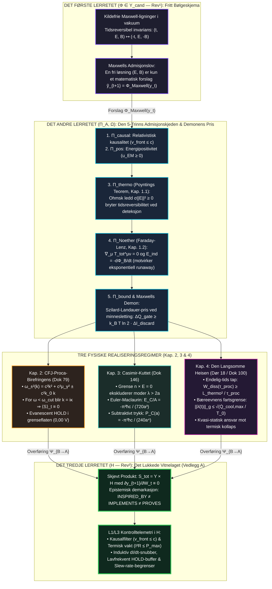

# 35 — Bokhylla Bind XIV: *MAXWELL & DEMONENS PRIS — Elektrodynamisk Admisjon, CFJ-Proca-Birefringens og Casimir-Kuttet* (v3.0-MONOLITT)

**Forfatter:** Marius Egerhei Torjusen (Reismann-punktet Systemer, 2026)  
**Kilde:** [`07_BOKHYLLA_MONOGRAFIER_OG_BOKVERK/14_MAXWELL_ZENODO_KOMPENDIUM/MAXWELL_MONOGRAFI_DEMONENS_PRIS.pdf`](../../07_BOKHYLLA_MONOGRAFIER_OG_BOKVERK/14_MAXWELL_ZENODO_KOMPENDIUM/MAXWELL_MONOGRAFI_DEMONENS_PRIS.pdf)  
**Godot `L1` Motor:** [`04_REALITY_FORGE/RealityForge_Godot/scripts/maxwell_bind_xiv_admissibility_engine.gd`](../../04_REALITY_FORGE/RealityForge_Godot/scripts/maxwell_bind_xiv_admissibility_engine.gd) (`6/6 PASS`)

> **Demarkasjon (`L1`):** Programvaremotorene og de numeriske verifikasjonene er lokalt demonstrert programvare (`L1`). De respekterer grensen $\text{INSPIRED\_BY} \neq \text{IMPLEMENTS} \neq \text{PROVES}$, og bruker append-only hash-kjeder som programvare-vitner, ikke som fysisk WORM-maskinvare.

---

## 1. Hoveddiagram (ASCII): Den Elektromagnetiske Admisjonskjeden og De Tre Lerretene ($\mathcal{S}_{\text{tot}} = \mathcal{Y} \times \mathcal{H}$)

```text
========================================================================================================================
              BOKHYLLA BIND XIV: MAXWELL & DEMONENS PRIS — KANONISK MONOGRAFI (v3.0-MONOLITT)
       Π_A = Π_causal ∘ Π_pos ∘ Π_thermo ∘ Π_Noether ∘ Π_bound   |   ΔQ_gate ≥ k_B T ln 2   [ S_tot = Y × H ]
========================================================================================================================

  ┌──────────────────────────────────────────────────────────────────────────────────────────────────────────────────┐
  │ DET FØRSTE LERRETET (Φ ∈ Y_cand — Rev¹): REVERSIBELT BØLGESKJEMA & UFORPLIKTET FORSLAGSROM                       │
  ├──────────────────────────────────────────────────────────────────────────────────────────────────────────────────┤
  │  • Kildefrie Maxwell-ligninger i vakuum : Invariante under tidsreversering (t, E, B) ↦ (-t, E, -B)               │
  │  • Maxwells Admisjonslov                : En fri løsning (E, B) er kun et matematisk forslag ỹ_{t+1} = Φ_Max(y_t)│
  └────────────────────────────────────────────────────────┬─────────────────────────────────────────────────────────┘
                                                           │  Feltkandidat (E, B) ∈ Y_cand
                                                           ▼
  ┌──────────────────────────────────────────────────────────────────────────────────────────────────────────────────┐
  │ DET ANDRE LERRETET (Π_A, Ω): DEN FEM-TRINNS ELEKTROMAGNETISKE ADMISJONSKJEDEN & MAXWELLS DEMON                   │
  ├──────────────────────────────────────────────────────────────────────────────────────────────────────────────────┤
  │  [1] Π_causal  (Kausal Lysgrense)      : Frontfart v_front ≤ c  (Relativistisk lyskjegle-admissibilitet)         │
  │  [2] Π_pos     (Energipositivitet)     : Elektromagnetisk energitetthet u_EM = ½(ε E² + μ⁻¹ B²) ≥ 0             │
  │  [3] Π_thermo  (Poynting-Dissipasjon)  : -∂_t ∫ u_EM dV = ∮ (E × H)·dA + ∫ σ ||E||² dV                           │
  │                                          Ohmsk ledd σ ||E||² ≥ 0 bryter tidsreversibilitet ved deteksjon/arbeid! │
  │  [4] Π_Noether (Faraday-Lenz & Balanse): ∇_μ T_tot^μν = 0  og  E_ind = ∮ E·dl = -dΦ_B/dt                         │
  │                                          Det negative fortegnet (Lenz) forhindrer eksponentiell vakuum-runaway!  │
  │  [5] Π_bound   (Kavitets- & Portkutt)  : Szilard-Landauer-Bennett-prisen i demonens minne:                       │
  │                                          ΔQ_gate ≥ k_B T ln 2 · ΔI_discard                                       │
  └───────────────┬────────────────────────────────────────┬────────────────────────────────────────┬────────────────┘
                  │                                        │                                        │
                  ▼ (Kapittel 2: Chiralt Faseskille)       ▼ (Kapittel 3: Subtraktivt Vakuum)       ▼ (Kapittel 4: Dør 18)
  ┌──────────────────────────────────────┐ ┌──────────────────────────────────────┐ ┌────────────────────────────────┐
  │ CFJ-PROCA-BIREFRINGENS & HOLD        │ │ CASIMIR-KUTTET (Dok 146)             │ │ DEN LANGSOMME HEISEN (Dør 18)  │
  ├──────────────────────────────────────┤ ├──────────────────────────────────────┤ ├────────────────────────────────┤
  │ • Lagrange-tetthet L_CFJ-Proca (Dok79│ │ • Ledende plater ved z=0 og z=a:     │ │ • Endelig-tids termodynamikk   │
  │   med Proca-gap μ_γ og aksialvektor  │ │   n × E = 0 kutter bort alle moder   │ │   langs kontrollbane λ(t):     │
  │   (k_AF)_μ.                          │ │   med k_z ≠ nπ/a (λ > 2a ekskludert).│ │   W_diss(τ_proc) ≥ L_thermo² / │
  │ • Chiral dispersjonsrelasjon:        │ │ • Euler-Maclaurin-regularisering:    │ │                    τ_proc      │
  │   ω_±²(k) = c²k² + c²μ_γ² ± c²k_0 k  │ │   E_C(a)/A = -π² ħ c / (720 a³)      │ │ • Bæreevnens fartsgrense:      │
  │ • Evanescent Frekvensgap:            │ │ • Subtraktivt sammenholdstrykk:      │ │   ||λ̇(t)||_g ≤ √(Q̇_cool,max/T0)│
  │   ω < ω_cut ==> k = iκ (imaginært)   │ │   P_C(a) = -π² ħ c / (240 a⁴)        │ │ • Slew-rate-skranke forhindrer │
  │   ==> ⟨S⟩_t ≡ 0  (EVANESCENT HOLD!)  │ │   Grensekutt skaper reell kraft!     │ │   termisk sammenbrudd!         │
  └──────────────────┬───────────────────┘ └──────────────────┬───────────────────┘ └───────────────┬────────────────┘
                     │                                        │                                     │
                     └────────────────────────────────────────┼─────────────────────────────────────┘
                                                              ▼
  ┌──────────────────────────────────────────────────────────────────────────────────────────────────────────────────┐
  │ DET TREDJE LERRETET (H — Rev²): DET LUKKEDE VITNELAGET & ELEKTROMAGNETISK TELEMETRI (Vedlegg A)                  │
  ├──────────────────────────────────────────────────────────────────────────────────────────────────────────────────┤
  │  • Skjevt Produkt & Kausal Lukking : S_tot = Y × H   med   ∂y_{t+1} / ∂W_t ≡ 0  (Ingen tilbakevirkning til Y)    │
  │  • L1/L3 Maskinvare-Realisering    :                                                                             │
  │    - Π_causal (v_front ≤ c)        ──> Tidsstempel- og kausalitetsfilter på datastrøm                            │
  │    - Π_thermo (σ||E||² ≥ 0)        ──> Termisk strøm- og effektsensor (I²R ≤ P_max)                              │
  │    - Faraday-Lenz (-dΦ_B/dt)       ──> Induktiv dI/dt-snubber og flyback-dempning                                │
  │    - CFJ-Proca (ω < ω_cut)         ──> Lavfrekvent HOLD-buffer (0,00 V DC)                                       │
  │    - Dør 18 (||λ̇||_g-grense)       ──> Slew-rate-begrenser og trinnvis ramp-kontroll                             │
  └──────────────────────────────────────────────────────────────────────────────────────────────────────────────────┘
```

---

## 2. Mermaid-Diagram: Bind XIV — Elektrodynamisk Realisering og De Tre Lerretene



---

## 3. Komparativ Syntesetabell: Bind X (Gravitasjon) vs. Bind XIV (Elektrodynamikk)

| Dimensjon / De Tre Lerretene | **BOKHYLLA BIND X: EINSTEIN & FELTLIGNINGENE** | **BOKHYLLA BIND XIV: MAXWELL & DEMONENS PRIS** |
| :--- | :--- | :--- |
| **1. Første Lerret ($\Phi \in \mathcal{Y}_{\text{cand}}$, $\text{Rev}^1$)** | Underbestemte feltligninger $G_{\mu\nu} + \Lambda g_{\mu\nu} = \kappa T_{\mu\nu}$ med $\operatorname{Diff}(\mathcal{M}_4)$ og Gödels CTC ($r_0 > \ln(1+\sqrt{2})$). | Kildefrie, tidsreversible Maxwell-ligninger i vakuum under $(t, \mathbf{E}, \mathbf{B}) \mapsto (-t, \mathbf{E}, -\mathbf{B})$. |
| **2. Andre Lerret ($\Pi_{\mathcal{A}}, \Omega$)** | Moreau-resolvent $\Pi_{\mathcal{A}} = (I + N_{\mathcal{A}})^{-1}$ på globalt hyperbolske metrikker og Petrov Type D kjerne $D_{\text{adm}}(\Psi_2)$. | Fem-trinns kjede $\Pi_{\mathcal{A}} = \Pi_{\text{causal}} \circ \Pi_{\text{pos}} \circ \Pi_{\text{thermo}} \circ \Pi_{\text{Noether}} \circ \Pi_{\text{bound}}$. |
| **Subtraktivt Grensetrykk / Stress** | Irreversibelt projeksjonsstress $\Sigma_{\mu\nu}^{\text{irr}} \propto \epsilon^{-2}\operatorname{sech}^4(d/2\epsilon)$ over eikonal-porten ($\epsilon \ge 2l_P$). | Subtraktivt Casimir-trykk $P_C(a) = -\frac{\pi^2\hbar c}{240a^4}$ ved eksklusjon av vakuummoder $\lambda > 2a$. |
| **HOLD-Regulering i Bufferbeltet** | 4.-ordens elliptisk Nash-operator $\mathcal{N}(g) = \Delta_g R = 0$ via Nash–Moser i tamme Fréchet-rom. | CFJ–Proca chiral splitting $\omega_\pm^2(k) = c^2k^2 + c^2\mu_\gamma^2 \pm c^2k_0k$ med evanescent **HOLD** ($\langle\mathbf{S}\rangle_t \equiv 0$) for $\omega < \omega_{\text{cut}}$. |
| **Termodynamisk Pris & Fartsgrense** | Gouy–Stodola $\dot{E}x_{\text{dest}} = T_0\dot{S}_{\text{gen}}$ og Clausius-horisontbalanse $\delta_i S_{\Pi_{\mathcal{K}}} \ge k_B\ln 2 \cdot \Delta I_{\text{cut}}$. | Szilard–Landauer $\Delta Q_{\text{gate}} \ge k_B T \ln 2$, Poynting-tap $\sigma\|\mathbf{E}\|^2 \ge 0$ og Dør 18 $W_{\text{diss}} \ge \mathcal{L}_{\text{thermo}}^2/\tau_{\text{proc}}$. |
| **3. Tredje Lerret ($\mathcal{H}$, $\text{Rev}^2$)** | Fréchet-isomorfi $DD_{\text{adm}}[g]\cdot h$ til galvanisk relékutt $V_{\text{out}} = V_0\Theta(D_{\text{adm}}-\tau_{\text{crit}})$ med $\partial y_{t+1}/\partial W_t \equiv 0$. | L1/L3 telemetri: kausalfilter, $I^2R$-vakt, $dI/dt$-snubber (Lenz), lavfrekvent HOLD-buffer og Dør 18 slew-rate-begrenser. |
