# 36 — Bokhylla Bind XI: *REVERSIBILITET & INVOLUSJON — $\text{Reversible}^2$: Lokal Involusjon og Domenegrensen mot Konsekvens* (v3.0-MONOLITT)

**Forfatter:** Marius Egerhei Torjusen (Reismann-punktet Systemer, 2026)  
**Kilde:** [`07_BOKHYLLA_MONOGRAFIER_OG_BOKVERK/11_REVERSIBILITET_ZENODO_KOMPENDIUM/REVERSIBILITET_MONOGRAFI_REVERSIBLE_SQUARED.pdf`](../../07_BOKHYLLA_MONOGRAFIER_OG_BOKVERK/11_REVERSIBILITET_ZENODO_KOMPENDIUM/REVERSIBILITET_MONOGRAFI_REVERSIBLE_SQUARED.pdf)  
**Godot `L1` Motor:** [`04_REALITY_FORGE/RealityForge_Godot/scripts/reversibility_bind_xi_admissibility_engine.gd`](../../04_REALITY_FORGE/RealityForge_Godot/scripts/reversibility_bind_xi_admissibility_engine.gd) (`6/6 PASS`)

> **Demarkasjon (`L1`):** Programvaremotorene og de numeriske verifikasjonene er lokalt demonstrert programvare (`L1`). De respekterer grensen $\text{INSPIRED\_BY} \neq \text{IMPLEMENTS} \neq \text{PROVES}$, og bruker append-only hash-kjeder som programvare-vitner, ikke som fysisk WORM-maskinvare.

---

## 1. Hoveddiagram (ASCII): Den Doble Reversibilitetsarkitekturen ($\text{Reversible}^2$) og De Fire Domenene ($D_0 \to D_3$)

```text
========================================================================================================================
              BOKHYLLA BIND XI: REVERSIBILITET & INVOLUSJON — KANONISK MONOGRAFI (v3.0-MONOLITT)
       Rev¹: F(F(s)) = s (i D_0 ∪ D_1)   |   Rev²: Dom(F) ∩ D_2 = ∅   |   R = 2P - I   [ S_tot = Y × H ]
========================================================================================================================

  ┌──────────────────────────────────────────────────────────────────────────────────────────────────────────────────┐
  │ 1. DOMENE D_0: FASEMINNETS LUFTSLUSE & MASKINENS GJESTEVÆRELSE (Dør 14 — Kapittel 2 & 3)                         │
  ├──────────────────────────────────────────────────────────────────────────────────────────────────────────────────┤
  │  • 5-Tuppel Kandidattilstand : s_rev = (x, θ, K, σ, m) ∈ S_rev                                                   │
  │  • Luftslusebetingelse       : Δs_irr ≡ 0   ∧   Ω(s_rev) = NO_EFFECT                                             │
  │  • Teorem 2.1 (Involusjons-Projeksjons-Isomorfien):                                                              │
  │    Enhver involusjon R² = I korresponderer entydig til idempotent projektor P = ½(I + R) (P² = P) via:           │
  │          R = 2P - I ,   H = H_+ ⊕ H_- ,   ||s - R(s)||_M = 2 ||s - P(s)||_M = 2 Δ_K(s)                           │
  │  • Kvante- & Paritetsinvolusjon (Kapittel 3):                                                                    │
  │    - Bloch-Sfære (Dok 81)  : F_n̂(ρ) = U_n̂ ρ U_n̂†  (U_n̂ = n̂·σ⃗),   F_n̂(F_n̂(ρ)) = ρ                                │
  │    - Dual-Rail Z_2^{1000}  : J(s) = 1 - s (J² = I) med kritisk balanselinje Re(s) = ½  (b_i^+ ⊕ b_i^- = 1)       │
  └────────────────────────────────────────────────────────┬─────────────────────────────────────────────────────────┘
                                                           │  s_rev sendes til Pre-Commit-prøving
                                                           ▼
  ┌──────────────────────────────────────────────────────────────────────────────────────────────────────────────────┐
  │ 2. DOMENE D_1: PRE-COMMIT VERIFIKASJONSROM & TRE-LÅS-SEPARASJONEN (Kapittel 4)                                   │
  ├──────────────────────────────────────────────────────────────────────────────────────────────────────────────────┤
  │  • ROSETTA² Bi-Lipschitz Kondisjonering (4.1):                                                                   │
  │    L_1 ||x_1 - x_2||_X ≤ ||E(x_1) - E(x_2)||_Y ≤ L_2 ||x_1 - x_2||_X ,   κ(E) = L_2 / L_1 < κ_max                │
  │  • Teorem 4.1 (Tre-Lås-Separasjonen — Vern mot CVE-2026-INV-COLLISION som F_attack(s) = -s):                     │
  │    Ω = OPEN krever SAMTIDIG oppfyllelse av tre ortogonale låser (Den Utvidede Trinity-Løkken):                   │
  │      [LÅS 1: Kanalisometri (Rev¹)]    ||F(F(s)) - s|| ≤ ε_num  (IEEE-754: ε_num = 10^{-12} i H)                  │
  │      [LÅS 2: Operatorintegritet]      V_op(F, s_0) = 1  ∧  Fikspunktankring i H_+ = Im(P)                        │
  │      [LÅS 3: Barriere & Horisont t*]  g(F(s)) ≤ 0   ∧   t < t* = (1/λ) ln(D_crit / D_0)                          │
  └──────────────────────────┬─────────────────────────────────────────────────────────────┬─────────────────────────┘
                             │ Alle 3 låser PASS (Ω = OPEN)                                │ Brudd på Lås 1, 2 eller 3
                             ▼ (Point-of-No-Return!)                                       ▼ (Ω = KILL < 0,4 ns)
  ┌────────────────────────────────────────────────────────┐    ┌────────────────────────────────────────────────────┐
  │ 3. DOMENE D_2: IRREVERSIBEL KONSEKVENS (Kapittel 1)    │    │ 4. DOMENE D_3: DET LUKKEDE VITNELAGET H (Kap. 5/A) │
  ├────────────────────────────────────────────────────────┤    ├────────────────────────────────────────────────────┤
  │ • Operativ spenning : 5,00 V DC logikk / 24,0 V DC rail│    │ • Galvanisk Crowbar-kutt til 0,00 V DC (x_stasis)  │
  │ • Rev² (Domenegrense): Dom(F) ∩ D_2 = ∅                │    │ • Skjevt produkt : S_tot = Y × H (∂y_{t+1}/∂W_t≡0) │
  │ • Den Forbudte Setningen:                              │    │ • Epoke-Separert Gjenåpning (R_AUTH, Kapittel 5):  │
  │   «En fullbyrdet commit i D_2 kan reverseres» er       │    │   R_AUTH: S_stasis^(k) × W_ext^(k+1) ──> D_0^(k+1) │
  │   konstitusjonelt forbudt (ANTI_REVERSIBLE_VIOLATION). │    │   med ∂D_3^(k) / ∂R_AUTH ≡ 0 (Fortiden er frosset!)│
  │ • Anti-Reversibilitetens Termodynamikk (1.2):          │    │ • Kryptografisk Epokelenking (Spec 128):           │
  │   Handling u_1 ved t_1 + kompensasjon u_2 = -u_1 ved   │    │   H_0^(k+1) = SHA256(H_final^(k) || Warrant^(k+1)  │
  │   t_2 > t_1 gir:                                       │    │                      || k+1)                       │
  │   ΔS_tot = ΔS_1 + ΔS_2 ≥ 2 k_B ln 2 > 0 !              │    │   (Ed25519 PK_ROOT i ROM + fysisk 0x55 strobe)     │
  └────────────────────────────────────────────────────────┘    └──────────────────────────┬─────────────────────────┘
                                                                                           │ Ny epoke k+1 (Kun til D_0!)
                                                                                           └───────────────► [Til D_0]
```

---

## 2. Mermaid-Diagram: Bind XI — $\text{Reversible}^2$, Spektral Involusjon og $\mathcal{R}_{\text{AUTH}}$

```mermaid
flowchart TD
    classDef d0 fill:#1e1e2f,stroke:#7c4dff,stroke-width:2px,color:#ffffff
    classDef d1 fill:#1a2639,stroke:#00b4d8,stroke-width:2px,color:#ffffff
    classDef d2 fill:#0f291e,stroke:#2dc653,stroke-width:3px,color:#ffffff
    classDef d3 fill:#371212,stroke:#e63946,stroke-width:3px,color:#ffffff
    classDef rauth fill:#2d231e,stroke:#ff9f1c,stroke-width:2px,color:#ffffff

    subgraph DOM0 ["DOMENE D_0: Kandidat- og Faseminne (Maskinens Gjesteværelse, Dør 14)"]
        A1["5-Tuppel Tilstandsvektor: s_rev = (x, θ, K, σ, m) ∈ S_rev<br/>Luftslusebetingelse: Δs_irr ≡ 0  ∧  Ω(s_rev) = NO_EFFECT"]
        A2["Teorem 2.1 (Involusjons-Projeksjons-Isomorfien):<br/>R = 2P - I  (R² = I ⇔ P² = P),  H = H_+ ⊕ H_-<br/>||s - R(s)||_M = 2 ||s - P(s)||_M = 2 Δ_K(s)"]
        A3["Kvante- & Paritetsinvolusjon (Kap. 3):<br/>• Bloch-sfære: F_n̂(ρ) = U_n̂ ρ U_n̂†  ⇒  F_n̂(F_n̂(ρ)) = ρ<br/>• Dual-rail Z_2^{1000}: J(s) = 1 - s med kritisk linje Re(s) = ½"]
    end

    subgraph DOM1 ["DOMENE D_1: Pre-Commit Verifikasjonsrom & Tre-Lås-Teoremet (Kap. 4)"]
        B1["ROSETTA² Bi-Lipschitz Kanalisometri (Kap. 4.1):<br/>L_1 ||x_1 - x_2|| ≤ ||E(x_1) - E(x_2)|| ≤ L_2 ||x_1 - x_2||,  κ(E) = L_2/L_1 < κ_max"]
        B2["Teorem 4.1 (Tre-Lås-Separasjonen mot CVE-2026-INV-COLLISION):<br/>1. Kanalisometri (Rev¹): ||F(F(s)) - s|| ≤ ε_num<br/>2. Operatorintegritet: V_op(F, s_0) = 1 ∧ Fikspunkt i H_+ = Im(P)<br/>3. Kontrollbarriere & Horisont: g(F(s)) ≤ 0 ∧ t < t* = (1/λ) ln(D_crit/D_0)"]
    end

    subgraph DOM2 ["DOMENE D_2: Irreversibel Materiell Konsekvens (Point-of-No-Return)"]
        C1["🟢 Ω = OPEN (5,00 V DC Logikk / 24,0 V DC Aktuatorrail)<br/>• Rev² (Domenegrense): Dom(F) ∩ D_2 = ∅<br/>• Den Forbudte Setningen: En fullbyrdet commit i D_2 kan ALDRI reverseres!<br/>• Anti-reversibilitet: u_1 etterfulgt av u_2 = -u_1 gir ΔS_tot = ΔS_1 + ΔS_2 ≥ 2 k_B ln 2 > 0"]
    end

    subgraph DOM3 ["DOMENE D_3: Det Forseglede Vitnelaget H & Feillukket Stasis"]
        D1["🔴 Ω = KILL (0,00 V DC Galvanisk Crowbar-kutt < 0,4 ns)<br/>• Låses i absorberende hviletilstand x_stasis^(k)<br/>• Skjevt produkt S_tot = Y × H med ∂y_{t+1}/∂W_t ≡ 0"]
    end

    subgraph EPOCH ["KAPITTEL 5: Epoke-Separert Gjenåpning (R_AUTH — Spec 128)"]
        E1["R_AUTH: S_stasis^(k) × W_ext^(k+1) ──> D_0^(k+1)  med  ∂D_3^(k)/∂R_AUTH ≡ 0<br/>• Fortiden i D_2^(k) og D_3^(k) forblir 100 % frosset!<br/>• H_0^(k+1) = SHA256(H_final^(k) || Warrant^(k+1) || k+1)<br/>• Krever Ed25519 PK_ROOT-signatur + 64-bits monoton teller + 0x55 fysisk strobe"]
    end

    A1 --> A2 --> A3
    A3 -->|"Pre-Commit prøving"| B1
    B1 --> B2
    B2 -->|"Alle 3 låser PASS"| C1
    B2 -->|"Brudd på Rev¹, V_op, g(x) eller t ≥ t*"| D1
    C1 -.->|"Forsøk på tilbakespoling i D_2 (Rev²-brudd)"| D1
    D1 -->|"Asymmetrisk mandat W_ext^(k+1)"| E1
    E1 -->|"Initialiserer NY epoke i D_0^(k+1)"| A1

    class A1,A2,A3 d0
    class B1,B2 d1
    class C1 d2
    class D1 d3
    class E1 rauth
```


