# 37 — Bokhylla Bind XII: *HENRI POINCARÉ & FASEROMMET — Dør 19, Rommet for Urealiserte Liv og Det Representasjonsløftede Snittet* (v3.0-MONOLITT)

**Forfatter:** Marius Egerhei Torjusen (Reismann-punktet Systemer, 2026)  
**Kilde:** [`07_BOKHYLLA_MONOGRAFIER_OG_BOKVERK/12_POINCARE_ZENODO_KOMPENDIUM/POINCARE_MONOGRAFI_FASEROMMET_OG_DOER_19.pdf`](../../07_BOKHYLLA_MONOGRAFIER_OG_BOKVERK/12_POINCARE_ZENODO_KOMPENDIUM/POINCARE_MONOGRAFI_FASEROMMET_OG_DOER_19.pdf)  
**Godot `L1` Motor:** [`04_REALITY_FORGE/RealityForge_Godot/scripts/poincare_bind_xii_admissibility_engine.gd`](../../04_REALITY_FORGE/RealityForge_Godot/scripts/poincare_bind_xii_admissibility_engine.gd) (`6/6 PASS`)

> **Demarkasjon (`L1`):** Programvaremotorene og de numeriske verifikasjonene er lokalt demonstrert programvare (`L1`). De respekterer grensen $\text{INSPIRED\_BY} \neq \text{IMPLEMENTS} \neq \text{PROVES}$, og bruker append-only hash-kjeder som programvare-vitner, ikke som fysisk WORM-maskinvare.

---

## 1. Hoveddiagram (ASCII): Dør 19, Gelfand-Tripler og Det Representasjonsløftede Snittet ($\mathcal{S}_{\text{tot}} = \mathcal{Y} \times \mathcal{H}$)

```text
========================================================================================================================
              BOKHYLLA BIND XII: HENRI POINCARÉ & FASEROMMET — KANONISK MONOGRAFI (v3.0-MONOLITT)
       V ↪ H ↪ V'   |   ||m_k - R(x_k)||_{Σ_k} ≤ ε_drift  ∧  ρ(DP_{Σ_k}^{fib}) < 1   |   Q_1–Q_10   [ S_tot = Y × H ]
========================================================================================================================

  ┌──────────────────────────────────────────────────────────────────────────────────────────────────────────────────┐
  │ PROLOG: STRENG DISAMBIGUERING AV TRE MATEMATISKE «POINCARÉ»-OBJEKTER (Eliminering av Aliasing)                   │
  ├──────────────────────────────────────────────────────────────────────────────────────────────────────────────────┤
  │  [1] Poincaré-Tverrsnitt Σ_k ⊂ M     : Sekvensielle kontrollflater i faserommet (Hovedgjenstand i Bind XII, Y)   │
  │  [2] Poincaré-Gruppen ISO(3,1)       : Relativistisk tangentsymmetri R^{1,3} ⋊ SO+(1,3) (Behandlet i Bind X)     │
  │  [3] Poincaré-Ballen B^n (||r|| < 1) : Konformt hyperbolsk modellrom ds² = 4||dr||²/(1-||r||²)² (L1 Stub i H)    │
  └────────────────────────────────────────────────────────┬─────────────────────────────────────────────────────────┘
                                                           │
                                                           ▼
  ┌──────────────────────────────────────────────────────────────────────────────────────────────────────────────────┐
  │ KAPITTEL 1: DØR 19 (ROMMET FOR UREALISERTE LIV) & DE TI TEMPORALE KONTROLLORGANENE (Q_1–Q_10)                    │
  ├──────────────────────────────────────────────────────────────────────────────────────────────────────────────────┤
  │  • Eliminering av Spøkelsesinterferens & Historisk Revisjonisme:                                                 │
  │    Forkastede kandidatbaner forsegles kryptografisk i Rommet for urealiserte liv og nektes adgang til Y.         │
  │  • De 10 Temporale Kontrollorganene i Serie:                                                                     │
  │    Q_1: Monoton klokke (Δτ_n > 0)       | Q_5: Hard sanntidsfrist (Δt ≤ deadline) | Q_9:  Det Temporale Vitnet   │
  │    Q_2: Kausal sekvensering (ingen hull)| Q_6: Time-To-Live (t ≤ t_issue + τ_TTL) | Q_10: Tidsporten (Subsumpsjon│
  │    Q_3: Kontekstbinding til aktiv A_n   | Q_7: Replay-blokkade                    |       KILL > HOLD > OPEN)    │
  │    Q_4: Lamport-klokke L_{n+1}=max+1    | Q_8: Retrokausalitetsføler (n+1 ↛ n)    |                              │
  └────────────────────────────────────────────────────────┬─────────────────────────────────────────────────────────┘
                                                           │
                                                           ▼
  ┌──────────────────────────────────────────────────────────────────────────────────────────────────────────────────┐
  │ KAPITTEL 2: LEVEDYKTIGHET I GELFAND-TRIPLER (V ↪ H ↪ V') & IKKE-LUKKENDE DYNAMIKK (Dok 71)                       │
  ├──────────────────────────────────────────────────────────────────────────────────────────────────────────────────┤
  │  • Moreau-Yosida-Regularisert Flyt med Minnekjerne K(t-s) og Ytre Pådrag G(x,t):                                 │
  │    dx/dt + A x(t) + ∫_0^t K(t-s) B x(s) ds + (1/ε)(x(t) - Π_A(x(t))) = G(x(t), t)                                │
  │  • Teorem 2.1 (Input-to-State Energi-Ulikhet):                                                                   │
  │    dE/dt + α_0 ||x(t)||_V² + (1/ε)||x(t) - Π_A(x(t))||_H² ≤ (1 / 2α_0) ||G(x(t), t)||_{V'}²                      │
  │  • Teorem 2.2 (Poincaré Non-Return / Ikke-Lukkende Dynamikk):                                                    │
  │    Med K(t) ≢ 0 og G(x,t) ≠ 0 har eksakt rå koordinatlukking x(t+T) = x(t) mål null i H!                         │
  └────────────────────────────────────────────────────────┬─────────────────────────────────────────────────────────┘
                                                           │  Løft til Fiberbunt E_fib = X × M_rep
                                                           ▼
  ┌──────────────────────────────────────────────────────────────────────────────────────────────────────────────────┐
  │ KAPITTEL 3 & 4: DET REPRESENTASJONSLØFTEDE POINCARÉ-SNITTET Σ_k & FROBENIUS-HOLONOMI (Dok 185)                   │
  ├──────────────────────────────────────────────────────────────────────────────────────────────────────────────────┤
  │  • Fiberpar z(t) = (x(t), m(t)) ∈ X × M_rep over transversale flater Σ_k (n_{Σ_k} · ẋ(t_k) > c_0 > 0)           │
  │  • Teorem 3.1 (Løsning på CVE-2026-GRAVITY-ORBIT-FALSE-KILL):                                                    │
  │    En åpen/aperiodisk bane x(t) (x(t_k) ≠ x(t_j)) er ADMISSIBLE ved Σ_k hvis og bare hvis normalfiberet          │
  │    e_k = m_k - R(x_k) oppfyller:                                                                                 │
  │          x(t) ∈ Viab(A)   ∧   sup_{k≥1} ||m_k - R(x_k)||_{Σ_k} ≤ ε_drift   ∧   ρ(DP_{Σ_k}^{fib}(0)) < 1          │
  │  • Frobenius-Integrabilitet & Null-Holonomi (Kap. 4.1):                                                          │
  │    Krumnings-2-form Ω_rep = dω + ω ∧ ω. Lukket testsløyfe γ = ∂D gir Δm_hol(γ) = ∬_D Ω_rep m_0 + O(Areal²).     │
  │    Hvis ||Δm_hol(γ)|| > ε_hol ==> Uintegrerbar modell stanses ved Σ_k!                                           │
  └──────────────────────────┬─────────────────────────────────────────────────────────────┬─────────────────────────┘
                             │ Admissibel ved Σ_k (Tåler retur / motstand)                 │ Avvist ved Q_1–Q_10 / Σ_k
                             ▼                                                             ▼
  ┌────────────────────────────────────────────────────────┐    ┌────────────────────────────────────────────────────┐
  │ 🟢 Ω = OPEN (KAP. 5: MOTSTAND OG FORM I Y)             │    │ 🔴 VEDLEGG A: DET LUKKEDE VITNELAGET H (DØR 19)    │
  ├────────────────────────────────────────────────────────┤    ├────────────────────────────────────────────────────┤
  │ • Bare det som tåler retur får lov til å bestå:        │    │ • Skjevt Produkt : S_tot = Y × H (∂y_{t+1}/∂W_t≡0) │
  │   P_A(x_0) = Π_A(Φ^{τ(x_0)}(x_0)) ∈ Σ_A                │    │ • Vern mot Landauer-DoS (Merkle-Batching, A.1):    │
  │ • Åpne og hyperbolske levedyktige baner passerer       │    │   Kun eskalerte port-avvisninger samles i M_root:  │
  │   uhindret uten False-Kill!                            │    │   W_{n+1} = SHA256(W_n||τ_n||L_n||M_root||Verdict) │
  │                                                        │    │ • Demarkasjon av SPEC-70B (FASE-SPEIL, A.2):       │
  │                                                        │    │   3D Poincaré-ball og SosioNomos er ren L1 test-   │
  │                                                        │    │   stub i H (INSPIRED_BY ≠ IMPLEMENTS ≠ PROVES).    │
  └────────────────────────────────────────────────────────┘    └────────────────────────────────────────────────────┘
```

---

## 2. Mermaid-Diagram: Bind XII — Faserommet, Dør 19 og Det Representasjonsløftede Snittet

```mermaid
flowchart TD
    classDef disamb fill:#1e1e2f,stroke:#7c4dff,stroke-width:2px,color:#ffffff
    classDef qgates fill:#1a2639,stroke:#00b4d8,stroke-width:2px,color:#ffffff
    classDef gelfand fill:#1b2d2a,stroke:#2ec4b6,stroke-width:2px,color:#ffffff
    classDef section fill:#2d231e,stroke:#ff9f1c,stroke-width:2px,color:#ffffff
    classDef open fill:#0f291e,stroke:#2dc653,stroke-width:3px,color:#ffffff
    classDef graveyard fill:#371212,stroke:#e63946,stroke-width:3px,color:#ffffff

    subgraph PROLOG ["PROLOG: Disambiguering av Tre Poincaré-Objekter"]
        P1["1. Poincaré-Tverrsnitt Σ_k ⊂ M (Dynamiske systemer — Hovedtema i Bind XII)<br/>2. Poincaré-Gruppen ISO(3,1) (Relativistisk symmetri — Behandlet i Bind X)<br/>3. Poincaré-Ballen B^n, ||r|| < 1 (Hyperbolsk modellrom — L1 Stub i Vedlegg A)"]
    end

    subgraph DOOR19 ["KAPITTEL 1: Dør 19 & De Ti Temporale Kontrollorganene (Q_1–Q_10)"]
        Q1["Eliminering av Spøkelsesinterferens & Historisk Revisjonisme:<br/>Forkastede baner kan aldri hentes frem som retrokausal sannhet"]
        Q2["Q_1 Monoton klokke (Δτ > 0) · Q_2 Kausal sekvensering · Q_3 Kontekstbinding A_n<br/>Q_4 Lamport-klokke L_{n+1}=max(L_n,L_msg)+1 · Q_5 Sanntidsfrist · Q_6 TTL<br/>Q_7 Replay-blokkade · Q_8 Retrokausalitetsføler · Q_9 Vitne · Q_10 Tidsport"]
    end

    subgraph GELFAND ["KAPITTEL 2: Gelfand-Tripler (V ↪ H ↪ V') & Ikke-Lukkende Dynamikk"]
        G1["Moreau-Yosida-Regularisert Flyt med Minne (Dok 71):<br/>dx/dt + Ax + ∫_0^t K(t-s)Bx(s)ds + (1/ε)(x - Π_A(x)) = G(x,t)"]
        G2["Teorem 2.1 (Energi-Ulikhet):<br/>dE/dt + α_0||x||_V² + (1/ε)||x - Π_A(x)||_H² ≤ (1/2α_0)||G||_{V'}²"]
        G3["Teorem 2.2 (Poincaré Non-Return):<br/>Med minnekjerne K ≢ 0 og pådrag G ≠ 0 har eksakt rå lukking x(t+T)=x(t) mål null!"]
    end

    subgraph LIFT ["KAPITTEL 3 & 4: Representasjonsløftet Snitt Σ_k & Frobenius-Holonomi"]
        S1["Løft til Fiberbunt E_fib = X × M_rep med z(t) = (x(t), m(t))<br/>Transversale kontrollflater Σ_k med n_{Σ_k} · ẋ(t_k) > c_0 > 0"]
        S2["Teorem 3.1 (Løsning på CVE-2026-GRAVITY-ORBIT-FALSE-KILL):<br/>x(t) ∈ Viab(A)  ∧  sup ||m_k - R(x_k)||_{Σ_k} ≤ ε_drift  ∧  ρ(DP_{Σ_k}^{fib}(0)) < 1"]
        S3["Kap. 4.1 Frobenius-Integrabilitet & Null-Holonomi:<br/>Ω_rep = dω + ω∧ω  ⇒  ||Δm_hol(γ)|| = ||∬_D Ω_rep m_0|| ≤ ε_hol"]
    end

    subgraph VERDICT ["KAPITTEL 5 & VEDLEGG A: Motstand og Form (Y) vs. Rommet for Urealiserte Liv (H)"]
        OPEN["🟢 Ω = OPEN (Kapittel 5: Motstand og Form)<br/>• P_A(x_0) = Π_A(Φ^{τ(x_0)}(x_0)) ∈ Σ_A<br/>• Åpne og hyperbolske levedyktige baner overlever snittet uten False-Kill<br/>• Kartet m_k svarer til terrenget R(x_k)"]
        KILL["🔴 Ω = KILL / HOLD (Vedlegg A: Det Lukkede Vitnelaget H)<br/>• Skjevt produkt S_tot = Y × H med ∂y_{t+1}/∂W_t ≡ 0<br/>• Merkle-Batching mot Landauer-DoS: W_{n+1} = SHA256(W_n || τ_n || L_n || M_root || Verdict)<br/>• Arkivert i Rommet for urealiserte liv (Dør 19) & SPEC-70B L1-demarkert"]
    end

    P1 --> Q1 --> Q2
    Q2 -->|"Kausal strøm"| G1
    G1 --> G2 --> G3
    G3 -->|"Løft (x, m) ∈ X × M_rep"| S1
    S1 --> S2 --> S3
    S3 -->|"||e_k|| ≤ ε_drift ∧ ρ < 1 ∧ ||Δm_hol|| ≤ ε_hol"| OPEN
    S3 -->|"||e_k|| > ε_drift ∨ ρ ≥ 1 ∨ Q_{1..10} Brudd"| KILL

    class P1 disamb
    class Q1,Q2 qgates
    class G1,G2,G3 gelfand
    class S1,S2,S3 section
    class OPEN open
    class KILL graveyard
```


