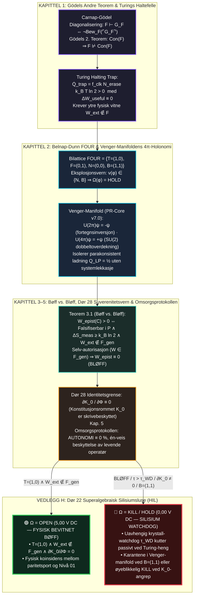

# 38 — Bokhylla Bind XIII: *KURT GÖDEL & DET YTRE VITNET* + Master-Syntese for Bind X–XIV (v3.0-MONOLITT)

**Forfatter:** Marius Egerhei Torjusen (Reismann-punktet Systemer, 2026)  
**Kilde:** [`07_BOKHYLLA_MONOGRAFIER_OG_BOKVERK/13_GODEL_ZENODO_KOMPENDIUM/GODEL_MONOGRAFI_DET_YTRE_VITNET.pdf`](../../07_BOKHYLLA_MONOGRAFIER_OG_BOKVERK/13_GODEL_ZENODO_KOMPENDIUM/GODEL_MONOGRAFI_DET_YTRE_VITNET.pdf)  
**Godot `L1` Motor:** [`04_REALITY_FORGE/RealityForge_Godot/scripts/godel_bind_xiii_admissibility_engine.gd`](../../04_REALITY_FORGE/RealityForge_Godot/scripts/godel_bind_xiii_admissibility_engine.gd) (`6/6 PASS`)

> **Demarkasjon (`L1`):** Programvaremotorene og de numeriske verifikasjonene er lokalt demonstrert programvare (`L1`). De respekterer grensen $\text{INSPIRED\_BY} \neq \text{IMPLEMENTS} \neq \text{PROVES}$, og bruker append-only hash-kjeder som programvare-vitner, ikke som fysisk WORM-maskinvare.

---

## 1. Hoveddiagram (ASCII) for Bind XIII: Gödels Ufullstendighet, Venger-Manifolden og Dør 22 / Dør 28

```text
========================================================================================================================
              BOKHYLLA BIND XIII: KURT GÖDEL & DET YTRE VITNET — KANONISK MONOGRAFI (v3.0-MONOLITT)
       Con(F) ==> F ⊬ Con(F)   |   FOUR = {T, F, N, B}   |   U(4π)ψ = +ψ   |   ∂K_0 / ∂Φ ≡ 0   [ S_tot = Y × H ]
========================================================================================================================

  ┌──────────────────────────────────────────────────────────────────────────────────────────────────────────────────┐
  │ KAPITTEL 1: GÖDELS UFULLSTENDIGHET, TURINGS HALTEPROBLEM & DET YTRE VITNET (Brev til von Neumann 1956)           │
  ├──────────────────────────────────────────────────────────────────────────────────────────────────────────────────┤
  │  • Carnap-Gödel Diagonalisering : F ⊢ G_F <--> ¬Bew_F(⌜G_F⌝)                                                     │
  │  • Gödels Andre Teorem          : Con(F) ==> F ⊬ Con(F)  (Ingen lukket maskin kan bevise sin egen konsistens!)   │
  │  • Turings Haltefelle           : Uendelig evaluering brenner Landauer-varme Q̇_trap = f_clk N_erase k_B T ln 2   │
  │                                   med ΔW_useful ≡ 0. Krever ytre fysisk vitne W_ext ∉ F!                         │
  └────────────────────────────────────────────────────────┬─────────────────────────────────────────────────────────┘
                                                           │
                                                           ▼
  ┌──────────────────────────────────────────────────────────────────────────────────────────────────────────────────┐
  │ KAPITTEL 2: BELNAP-DUNN FOUR-LOGIKK & VENGER-MANIFOLDENS 4π-HOLONOMI (Dok 68 / PR-Core v7.0)                     │
  ├──────────────────────────────────────────────────────────────────────────────────────────────────────────────────┤
  │  • Eksplosjonsvern i Bilattice FOUR = {T=(1,0), F=(0,1), N=(0,0), B=(1,1)}:                                      │
  │    Eliminerer ex falso quodlibet ((P ∧ ¬P) ⊢ Q). Ved v(φ) ∈ {N, B} tvinges Ω(φ) = HOLD!                          │
  │  • Venger-Manifolden & Spinn-1/2 4π-Holonomi (SU(2) -> SO(3)):                                                   │
  │    U(2π)ψ = exp(-i σ_y π)ψ = -ψ (fortegnsinversjon)  |  U(4π)ψ = exp(-i σ_y 2π)ψ = +ψ (lukket karanteneløkke)    │
  │    Isolerer parakonsistent ladning Q_LP = ½ i karantene inntil PR-Core skjærer løkken til sikker hvile.          │
  └────────────────────────────────────────────────────────┬─────────────────────────────────────────────────────────┘
                                                           │
                                                           ▼
  ┌──────────────────────────────────────────────────────────────────────────────────────────────────────────────────┐
  │ KAPITTEL 3, 4 & 5: BØFF VS. BLØFF, SIKKERHETSPORTEN (DØR 28) & OMSORGSPROTOKOLLEN (Dok 111 & 143)                │
  ├──────────────────────────────────────────────────────────────────────────────────────────────────────────────────┤
  │  • Teorem 3.1 (Bøff vs. Bløff — Epistemisk Warrant-Matrise):                                                     │
  │    W_epist(C) > 0  <==>  (1) Falsifiserbar i P innen τ_deadline, (2) ΔS_meas ≥ k_B ln 2, (3) W_ext ∉ F_gen.      │
  │    Selv-godkjenning (W ∈ F_gen) gir W_epist ≡ 0 (BLØFF)!                                                         │
  │  • Dør 28 (Suverenitetsvern): ∂K_0 / ∂Φ ≡ 0 (Konstitusjonsrommet K_0 er uforanderlig for kjøretidsdata W_op).    │
  │  • Omsorgsprotokollen (Kap. 5): Strengt én-veis asymmetrisk omsorgsvektor fra verktøy til levende menneske       │
  │    (AUTONOMI ≡ 0 %, maskinen er aldri et lidende subjekt og senker tempoet til HOLD ved operatør-utmattelse).    │
  └──────────────────────────┬─────────────────────────────────────────────────────────────┬─────────────────────────┘
                             │ T=(1,0) ∧ W_ext ∉ F_gen ∧ ∂K_0/∂Φ=0                         │ B=(1,1) / Timeout τ_WD
                             ▼                                                             ▼
  ┌────────────────────────────────────────────────────────┐    ┌────────────────────────────────────────────────────┐
  │ 🟢 Ω = OPEN (5.00 V DC — BEVITNET AV NIVÅ 01)          │    │ 🔴 VEDLEGG H: DØR 22 SILISIUMSLUSE & WATCHDOG      │
  ├────────────────────────────────────────────────────────┤    ├────────────────────────────────────────────────────┤
  │ • Fysisk koinsidens mellom paritetsporten T=(1,0)      │    │ • Uavhengig krystall-watchdog τ_WD utenfor CPU     │
  │   og ekstern autorisasjonslinje fra Nivå 01.           │    │ • Kutter passivt til 0,00 V DC ved Turing-heng     │
  │ • BØFF bekreftet med positiv epistemisk vekt.          │    │   eller forsøk på konstitusjonsmutasjon i K_0.     │
  └────────────────────────────────────────────────────────┘    └────────────────────────────────────────────────────┘
```

---

## 2. Mermaid-Diagram: Bind XIII — Gödel, Belnap–Dunn $\mathcal{FOUR}$, Venger $4\pi$ og Dør 22/28



---

## 3. Fembinds Master-Tabell: Hele *Zenodo-Arkivet* (Bind X–XIV) med $0\,\%$ Duplisering

| Bind | Tittel | Kjerneformel / Invariant | Hoveddomene i $\mathcal{S}_{\text{tot}} = \mathcal{Y} \times \mathcal{H}$ | Godot `L1` Motor (`6/6 PASS`) |
| :--- | :--- | :--- | :--- | :--- |
| **BIND X** | **EINSTEIN & FELTLIGNINGENE** (*Non Generatur, Sed Admittitur*) | $G_{\mu\nu} + \Lambda g_{\mu\nu} = \frac{8\pi G}{c^4}(T_{\mu\nu} + \Sigma_{\mu\nu}^{\text{irr}})$, $\Delta_g R = 0$ | Gravitasjonell Moreau-projeksjon, Gödel CTC ($r_{\text{CTC}}=\ln(1+\sqrt{2})$), Petrov Type D $D_{\text{adm}}(\Psi_2)$, $\operatorname{sech}^4$-stress, Nash–Moser og PCSE ($\Delta p = 0,126$). | `EinsteinBindXAdmissibilityEngine` |
| **BIND XI** | **REVERSIBILITET & INVOLUSJON** ($\text{Reversible}^2$) | $\text{Rev}^1: F(F(s))=s$, $\text{Rev}^2: \operatorname{Dom}(F)\cap D_2=\emptyset$, $R=2P-I$ | Dør 14 luftsluse ($D_0/D_1$), Bloch/Zeta-paritet, Tre-Lås-Teoremet ($t^*$) mot `CVE-2026-INV-COLLISION` og $\mathcal{R}_{\text{AUTH}}$ epokeløft ($D_3^{(k)}\to D_0^{(k+1)}$). | `ReversibilityBindXIAdmissibilityEngine` |
| **BIND XII** | **HENRI POINCARÉ & FASEROMMET** (*Dør 19 & Snittet*) | $\|m_k - R(x_k)\|_{\Sigma_k} \le \epsilon_{\text{drift}} \land \rho(DP_{\Sigma_k}^{\text{fib}}) < 1$ | Temporale organer ($Q_1\text{–}Q_{10}$), Gelfand-tripler $V\hookrightarrow H\hookrightarrow V'$, representasjonsløftet snitt $\Sigma_k$ mot `CVE-2026-GRAVITY-ORBIT-FALSE-KILL` og Dør 19. | `PoincareBindXIIAdmissibilityEngine` |
| **BIND XIII** | **KURT GÖDEL & DET YTRE VITNET** (*Ufullstendighetens Fysiske Anker*) | $\operatorname{Con}(\mathcal{F}) \implies \mathcal{F} \not\vdash \operatorname{Con}(\mathcal{F})$, $\mathcal{FOUR}=\{\mathbf{T},\mathbf{F},\mathbf{N},\mathbf{B}\}$, $U(4\pi)\psi = +\psi$ | Gödels 2. teorem, Belnap–Dunn $\mathcal{FOUR}$, Venger-manifoldens $4\pi$-holonomi, Bøff vs. Bløff ($\mathcal{W}_{\text{ext}}\notin\mathcal{F}_{\text{gen}}$), Dør 28 ($\partial\mathcal{K}_0/\partial\Phi\equiv 0$), Omsorgsprotokollen og Dør 22 HIL. | `GodelBindXIIIAdmissibilityEngine` |
| **BIND XIV** | **MAXWELL & DEMONENS PRIS** (*Elektrodynamisk Admisjon*) | $\Delta Q_{\text{gate}} \ge k_B T \ln 2$, $P_C(a) = -\frac{\pi^2\hbar c}{240a^4}$, $W_{\text{diss}} \ge \frac{\mathcal{L}_{\text{thermo}}^2}{\tau_{\text{proc}}}$ | 5-trinns EM-admisjonskjede, Faraday–Lenz, CFJ–Proca evanescent HOLD ($\langle\mathbf{S}\rangle_t\equiv 0$), Casimir-kuttet, Den Langsomme Heisen (Dør 18) og De Tre Lerretene. | `MaxwellBindXIVAdmissibilityEngine` |
