# DOKUMENT 41: HAMILTONIAN JEPA (H-JEPA) — PORT-HAMILTONSK VERDENSMODELL MED ARVET KONTROLLTILSTAND OG REALITY FORGE (`L1`) SYNTESE

**Kildegrunnlag:** Tamim Zoabi, Ameen Ali & Lior Wolf (The Blavatnik School of Computer Science, Tel Aviv University, `arXiv:2609.33497v1 [cs.LG]`, 27. september 2026): *«Hamiltonian JEPA: Action-Conditioned World Models with an Inherited Control State»* — koblet mot **Bokhylla Bind X–XIV** og **Reality Forge Godot 4.3 (`L1`)** under kardinal-aksiomet:
$$\text{INSPIRED\_BY} \neq \text{IMPLEMENTS} \neq \text{PROVES}$$

---

## 1. Hvorfor H-JEPA er en direkte strukturell tvilling til Bind X–XIV og Reality Forge

Zoabi, Ali & Wolf (2026) løser et fundamentalt problem i handlingsbetingede verdensmodeller (*Joint-Embedding Predictive Architectures*, JEPA):
> **Stabilitet i representasjonsrommet er ikke det samme som kontrollerbarhet.** Hvis samme embedding tvinges til å tjene både persepsjon (anti-kollaps/isotropi) og kontroll (planlegging under handlinger), oppstår tre strukturelle feilmodi:
> 1. Planleggingsmetrikken blander kontroll-relevante retninger med passive støy-/bakgrunnsdimensjoner som kun eksisterer for å tilfredsstille isotropi-prioren.
> 2. Anti-kollaps-prioren og prediksjonstapet kjemper om de samme koordinatene.
> 3. Lærbare projeksjoner eller ukoblede invers-dekodere ko-adapterer med dynamikken og kollapser til lav-rang eller skalerings-degenerasjon.

Løsningen i **H-JEPA** følger **nøyaktig samme arkitektoniske delingslinje** som *Poincaré–Moreau-slusen* og *Dør 19* i **Bind X–XIV**:

| H-JEPA (Zoabi, Ali & Wolf, 2026) | Bokhylla Bind X–XIV & Reality Forge (`L1`) | Matematisk Invarians |
| :--- | :--- | :--- |
| **Perseptuell Sfære $h_t \in \mathbb{R}^D$ ($D=192$)** via affin-fri $\text{LN}_0(z)$ med $\|h_t\|_2 = \sqrt{D}$ og $e^\top h_t = 0$ | **Uforpliktet Forslagsrom ($NP$) / Hele Faserommet** før kuttflaten | Fiksert sfærisk radius fjerner fri skaleringsflukt |
| **Fiksert Ortonormalt Snitt $s_t = U^\top h_t \in \mathbb{R}^r$** ($U^\top U = I_r$, aldri trent) | **Kuttflaten i $P$ ($\Sigma_k$) & Ikke-Tilbakevirkning** ($\partial y_{t+1}/\partial W_t \equiv 0$) | En lærbar $U$ ko-adapterer og kollapser rangen; fiksert $U$ gir eksakt **kovarians-arv** $\operatorname{Cov}(s) = U^\top \operatorname{Cov}(h) U$ |
| **Bures–Wasserstein Isotropi-Prior $\mathcal{L}_{\text{iso}}(H)$** med konstant gjenopprettende kraft $\partial_\sigma(\sigma-1)^2 \to -2$ når $\sigma \to 0$ | **Spektral Anti-Kollaps i de $(D-r)$ Uobserverte Fiber-Retningene** (Bind XII, Gelfand-trippel $V \hookrightarrow H \hookrightarrow V'$) | Hindrer at dimensjoner utenfor kontrollsnittet dør ($\lambda^{-1/2}$-divergens i egenverdi-derivert motvirker kollaps, mens SIGReg og $\|\hat{\Sigma}-I\|_F^2 \to 0$) |
| **Fase-Betinget Dissipativ Port-Hamiltonsk Dynamikk** $\dot{s} = (J - R_\theta(c_t))\nabla_s H_\theta(s_t, v_t) + G_\theta(c_t)\bar{a}_t$ | **Symplektisk Konservativ Flyt $J$ + Rayleigh–Onsager / Moreau Dissipasjon $R_\theta \succeq 0$ + Stiefel-Port $G_\theta$** (Bind XI, XII & XIV) | $J^\top = -J$ bevarer energi, $R_\theta = L_\theta L_\theta^\top \succeq 0$ fjerner energi, og Stiefel-porten $G_\theta^\top G_\theta = I_{d_a}$ låser handlings-skalaen ($\sigma_i(\partial F/\partial \bar{a}) = \Delta t$) |
| **Port-Inverse Consistency (PIC):** $\hat{u}_{t+i} - \bar{a}_{t+i} = \frac{1}{\Delta t} G_\theta(\hat{c}_{t+i})^\top \delta_{t+i+1}$ | **Taktikerens / Port-Transponert Ortogonalitets- & Kontroll-Projeksjon** | Ingen separat invers-dekoder: $G_\theta^\top$ er den **eksakte Moore–Penrose-pseudoinversen** til $G_\theta$, som vekter prediksjonsfeil langs portretningene med faktoren $1 + \frac{r}{d_a \Delta t^2}$ |

---

## 2. Eksakt Matematisk Destillering av H-JEPA (Likning 1–21)

### 2.1 Persepsjon på sfæren og det fikserte ortonormale kontrollsnittet (§3.1–§3.2 & Appendiks G)
Hver bilseramme $x_t$ kodes uavhengig via ViT-T/14 + MLP-projektor etterfulgt av affin-fri LayerNorm ($\text{LN}_0$):
$$h_t = \text{LN}_0(\text{MLP}(\text{ViT}(x_t))) \in \mathbb{R}^D, \qquad \text{LN}_0(z) = \sqrt{D}\,\frac{z - \operatorname{mean}(z)\mathbf{1}}{\|z - \operatorname{mean}(z)\mathbf{1}\|_2}$$
slik at $\|h_t\|_2 = \sqrt{D}$ og $e^\top h_t = 0$ for sentreringsretningen $e = \frac{1}{\sqrt{D}}\mathbf{1}$ ($\|e\|_2 = 1$).

Kontrolltilstanden $s_t \in \mathbb{R}^r$ ($r \le D$) trekkes ut via en **fiksert, frø-initialisert ortonormal matrise** $U \in \mathbb{R}^{D \times r}$ ($U^\top U = I_r$, generert én gang via QR-faktorisering):
$$s_t = U^\top h_t, \qquad v_t = s_t - s_{t-1}, \qquad c_t = [s_t, v_t] \in \mathbb{R}^{2r}$$
Fordi $U$ er fiksert og lineær, arver $s_t$ kovariansgeometrien direkte fra $h_t$:
$$\operatorname{Cov}(s) = U^\top \operatorname{Cov}(h) U$$
Ved isotropi-priorens mål $\operatorname{Cov}(h) = P = I_D - ee^\top$ blir målet for kontrolltilstandens kovarians:
$$\operatorname{Cov}(s) = I_r - w w^\top, \qquad w = U^\top e$$
Denne matrisen har:
* $(r - 1)$ egenverdier eksakt lik $1$, og
* **én eksepsjonell egenverdi** $\lambda_{\text{exc}} = 1 - \|U^\top e\|_2^2$ langs $w = U^\top e$, hvor $\|U^\top e\|_2^2 \sim \operatorname{Beta}\!\left(\frac{r}{2}, \frac{D-r}{2}\right)$ konsentrerer seg rundt $\frac{r}{D}$ (og ved $r = D$ gir $\|w\|_2^2 = 1 \implies \lambda_{\text{exc}} = 0$, altså én eksakt nullretning).

---

### 2.2 Bures–Wasserstein Isotropi-Prior og Gjenopprettende Kraft ved $\sigma \to 0$ (§3.3 & Appendiks H)
På tvers av batchen $H = \{h_j\}_{j=1}^n$ med empirisk gjennomsnitt $\hat{\mu}$ og kovarians $\hat{\Sigma}$ på hyperplanet $P = I_D - ee^\top$ minimeres den kvadrerte 2-Wasserstein-avstanden mellom $\mathcal{N}(\hat{\mu}, \hat{\Sigma})$ og $\mathcal{N}(0, P)$:
$$\mathcal{L}_{\text{iso}}(H) = \frac{1}{D} W_2^2\big(\mathcal{N}(\hat{\mu}, \hat{\Sigma}),\, \mathcal{N}(0, P)\big) = \frac{1}{D}\left(\|\hat{\mu}\|_2^2 + \sum_{i=1}^{D-1}\left(\sqrt{\hat{\lambda}_i} - 1\right)^2\right)$$
Hvorfor feiler euklidsk kovariansstraff $\|\hat{\Sigma} - I\|_F^2$ og SIGReg i H-JEPA? Fordi de $D - r$ retningene utenfor $U$-snittet ikke mottar noen gradient fra prediksjon eller PIC. Ved kjerneregelen $\frac{\partial \ell}{\partial \sigma} = 2\sigma \frac{\partial \ell}{\partial \lambda}$ ($\sigma = \sqrt{\lambda}$) oppfører de tre priorene seg fundamentalt ulikt når en retning er i ferd med å dø ($\sigma \to 0^+$):
$$\underbrace{\frac{\partial}{\partial \sigma}(\sigma - 1)^2 = 2(\sigma - 1) \xrightarrow{\sigma \to 0} -2}_{\text{Bures–Wasserstein }\left(\frac{\partial \ell}{\partial \lambda} = 1 - \lambda^{-1/2} \sim -\lambda^{-1/2}\right)}, \qquad \underbrace{\frac{\partial}{\partial \sigma}(\sigma^2 - 1)^2 = 4\sigma(\sigma^2 - 1) \xrightarrow{\sigma \to 0} 0}_{\text{Euklidsk }\|\hat{\Sigma}-I\|_F^2}, \qquad \underbrace{\frac{\partial}{\partial \sigma}T(\sigma) = -2\kappa\sigma + O(\sigma^3) \xrightarrow{\sigma \to 0} 0}_{\text{SIGReg (Epps–Pulley)}}$$
Kun **Bures–Wasserstein** opprettholder en konstant, ikke-forsvinnende gjenopprettende kraft ($-2$) ved kollapsgrensen $\sigma \to 0$.

---

### 2.3 Fase-Betinget Dissipativ Port-Hamiltonsk Dynamikk på Stiefel-Manifolden (§3.4)
For partalls $r$ defineres den kanoniske symplektiske matrisen $J \in \mathbb{R}^{r \times r}$, den skalare Hamilton-energien $H_\theta : \mathbb{R}^{2r} \to \mathbb{R}$, den positivt semidefinitte dissipasjonsmatrisen $R_\theta(c) = L_\theta(c) L_\theta(c)^\top \succeq 0$ (med nedre-triangulær $L_\theta$), og inngangsporten $G_\theta(c) \in \mathbb{R}^{r \times d_a}$ på **Stiefel-manifolden** $\operatorname{St}(d_a, r)$ via deriverbar tynn QR-faktorisering:
$$J = \begin{bmatrix} 0 & -I_{r/2} \\ I_{r/2} & 0 \end{bmatrix}, \qquad J^\top = -J, \qquad R_\theta(c) = L_\theta(c) L_\theta(c)^\top \succeq 0, \qquad G_\theta(c)^\top G_\theta(c) = I_{d_a}$$
Ett eksplisitt Euler-steg ($\Delta t = 1$) fra fase $c_t = [s_t, v_t]$ under normalisert handling $\bar{a}_t \in \mathbb{R}^{d_a}$ er:
$$\hat{s}_{t+1} = F_\theta(s_t, \bar{a}_t \mid c_t) = s_t + \Delta t \Big[ \underbrace{(J - R_\theta(c_t))\nabla_s H_\theta(s_t, v_t)}_{\text{passiv flyt (konservativ } J - \text{dissipativ } R_\theta\text{)}} + \underbrace{G_\theta(c_t)\bar{a}_t}_{\text{kontrollflyt (Stiefel-port)}} \Big]$$
Fordi $G_\theta(c_t)^\top G_\theta(c_t) = I_{d_a}$, har handlings-Jacobianen $\frac{\partial F_\theta}{\partial \bar{a}} = \Delta t\, G_\theta(c_t)$ **alle singulærverdier eksakt lik $\Delta t$**. Én enhet normalisert handling gir alltid én enhet direkte latent forskyvning.

---

### 2.4 Port-Inverse Consistency (PIC) Identiteten — Eksakt Feil-Revekting (§3.5 & Appendiks B)
Ved utrullingssteg $i$ trekkes den passive flyten fra den observerte forskyvningen $\frac{s_{t+i+1} - \hat{s}_{t+i}}{\Delta t}$ og leses ut gjennom **transponatet av den samme porten** $G_\theta(\hat{c}_{t+i})^\top$:
$$\hat{u}_{t+i} = G_\theta(\hat{c}_{t+i})^\top \left[ \frac{s_{t+i+1} - \hat{s}_{t+i}}{\Delta t} - (J - R_\theta(\hat{c}_{t+i}))\nabla_s H_\theta(\hat{s}_{t+i}, \hat{v}_{t+i}) \right]$$
Ved å sette inn Euler-steget $\hat{s}_{t+i+1}$ og bruke Stiefel-identiteten $G_\theta(\hat{c}_{t+i})^\top G_\theta(\hat{c}_{t+i}) = I_{d_a}$ følger den **eksakte algebraiske PIC-identiteten**:
$$\hat{u}_{t+i} - \bar{a}_{t+i} = \frac{1}{\Delta t} G_\theta(\hat{c}_{t+i})^\top \delta_{t+i+1}, \qquad \delta_{t+i+1} = s_{t+i+1} - \hat{s}_{t+i+1}$$
Dermed smelter det åpne prediksjonstapet $\mathcal{L}_{\text{pred}}$ og PIC-tapet $\mathcal{L}_{\text{PIC}}$ (for $K_{\text{PIC}} = K_p$) sammen til **én enkelt positivt definitt kvadratisk form** i utrullingsfeilen $\delta_{t+i}$:
$$\mathcal{L}_{\text{pred}} + \mathcal{L}_{\text{PIC}} = \frac{1}{|T| K_p r} \sum_{t \in T} \sum_{i=1}^{K_p} \delta_{t+i}^\top \underbrace{\left( I_r + \frac{r}{d_a \Delta t^2} G_{t+i-1} G_{t+i-1}^\top \right)}_{M_{\text{PIC}}(\hat{c}_{t+i-1})} \delta_{t+i}$$
* **Hva $M_{\text{PIC}}$ gjør:** Enhver feilvektor $\delta_\parallel \in \operatorname{span}(G_{t+i-1})$ langs de $d_a$ handlingsport-retningene vektes med den eksakte forsterkningsfaktoren:
  $$w_\parallel = 1 + \frac{r}{d_a \Delta t^2}$$
  mens feil $\delta_\perp \perp \operatorname{span}(G_{t+i-1})$ i de resterende $r - d_a$ retningene vektes med $w_\perp = 1$:
  * **Two-Room** ($r=32, d_a=2, \Delta t=1$): $w_\parallel = 1 + \frac{32}{2} = \mathbf{17,0}$
  * **Reacher** ($r=64, d_a=2, \Delta t=1$): $w_\parallel = 1 + \frac{64}{2} = \mathbf{33,0}$
  * **PushT** ($r=192, d_a=2, \Delta t=1$): $w_\parallel = 1 + \frac{192}{2} = \mathbf{97,0}$ (ved $r=64$: $\mathbf{33,0}$)
  * **OGB-Cube** ($r=32, d_a=5, \Delta t=1$): $w_\parallel = 1 + \frac{32}{5} = \mathbf{7,4}$
* **Hvorfor frikobling av porten ($Q^\top$ i stedet for $G_\theta^\top$) ødelegger identiteten (Likning 17):**
  $$\hat{u}_{t+i}^{\text{untied}} - \bar{a}_{t+i} = \frac{1}{\Delta t} Q^\top \delta_{t+i+1} + \underbrace{\big(Q^\top G_\theta(c) - I_{d_a}\big)\bar{a}_{t+i}}_{\text{parasittisk skjevhetsledd }\neq 0 \text{ for } G_\theta(c) \neq Q}$$
  som tvinger porten mot en fast ramme $Q$ i stedet for å følge tilstanden, og taper halvparten av planleggingsgevinsten (fra $93,3\,\%$ ned til $83,7\,\%$ på PushT).

---

## 3. Hoveddiagram (ASCII): H-JEPA $\leftrightarrow$ Reality Forge Consequence-Gated World Model

```text
========================================================================================================================
        HAMILTONIAN JEPA (H-JEPA) ↔ REALITY FORGE (L1): PORT-HAMILTONSK VERDENSMODELL MED ARVET KONTROLLTILSTAND
   h_t ∈ S^{D-1}(√D)  ──[U^T (Fiksert)]──►  s_t ∈ R^r  ──[(J - R_θ)∇H_θ + G_θ a_t]──►  ŝ_{t+1}  ──[Π_A (Sluse)]──► y_{t+1}
========================================================================================================================

  ┌──────────────────────────────────────────────────────────────────────────────────────────────────────────────────┐
  │ 1. PERSEPTUELL SFÆRE (NP-FORSLAGSROM) h_t ∈ R^D (D = 192) & BURES–WASSERSTEIN ISOTROPI-PRIOR L_iso               │
  ├──────────────────────────────────────────────────────────────────────────────────────────────────────────────────┤
  │  • Affin-fri sfærisk projeksjon:  h_t = LN_0(MLP(ViT(x_t))),   ||h_t||_2 = √D,   e^T h_t = 0  (e = 1/√D)         │
  │  • Bures–Wasserstein prior:       L_iso(H) = (1/D) [ ||μ̂||_2^2 + Σ_{i=1}^{D-1} (√λ̂_i - 1)^2 ]                    │
  │  • Konstant anti-kollaps-kraft:   ∂/∂σ (σ - 1)^2 = 2(σ - 1) ──(σ → 0)──► -2   (mens SIGReg & ||Σ̂-I||_F^2 ──► 0)  │
  └────────────────────────────────────────────────────────┬─────────────────────────────────────────────────────────┘
                                                           │
                             Fiksert Ortonormalt Snitt U ∈ R^{D×r} (U^T U = I_r, aldri trent)
                             Kovarians-arv: Cov(s) = U^T Cov(h) U = I_r - (U^T e)(U^T e)^T
                             Eksepsjonell egenverdi: λ_exc = 1 - ||U^T e||_2^2 ≈ 1 - r/D
                                                           │
                                                           ▼
  ┌──────────────────────────────────────────────────────────────────────────────────────────────────────────────────┐
  │ 2. KONTROLLTILSTAND s_t = U^T h_t ∈ R^r, PARAMETER-FRI FASE c_t = [s_t, v_t] ∈ R^{2r}  (v_t = s_t - s_{t-1})     │
  └────────────────────────────────────────────────────────┬─────────────────────────────────────────────────────────┘
                                                           │
                                                           ▼
  ┌──────────────────────────────────────────────────────────────────────────────────────────────────────────────────┐
  │ 3. FASE-BETINGET DISSIPATIV PORT-HAMILTONSK PREDIKTOR F_θ(s_t, ā_t | c_t) & STIEFEL-PORT G_θ(c_t)                │
  ├──────────────────────────────────────────────────────────────────────────────────────────────────────────────────┤
  │  • Symplektisk konservativ matrise:  J = [0, -I_{r/2}; I_{r/2}, 0],   J^T = -J   (∇_s H_θ^T J ∇_s H_θ ≡ 0)       │
  │  • Rayleigh–Onsager dissipasjon:     R_θ(c_t) = L_θ(c_t) L_θ(c_t)^T ⪰ 0          (∇_s H_θ^T R_θ ∇_s H_θ ≥ 0)     │
  │  • Stiefel handlingsport:            G_θ(c_t) ∈ R^{r×d_a},   G_θ(c_t)^T G_θ(c_t) = I_{d_a}  (QR-ortonormal)      │
  │  • Eksplisitt Euler-utrulling:       ŝ_{t+1} = s_t + Δt [ (J - R_θ(c_t)) ∇_s H_θ(s_t, v_t) + G_θ(c_t) ā_t ]     │
  └──────────────────────────┬─────────────────────────────────────────────────────────────┬─────────────────────────┘
                             │                                                             │
         Port-Inverse Consistency (PIC)                                    CEM-Planlegging & Konsekvens-Sluse Π_A
   û_{t+i} - ā_{t+i} = (1/Δt) G_θ(ĉ_{t+i})^T δ_{t+i+1}                   Rangerer kun ||ŝ_{t+K_p} - s_goal||_2^2
   Vekter port-feil med w_|| = 1 + r / (d_a Δt^2)                        Fysisk sluse Π_A krever bevis-ID + ortogonalitet
                             │                                                             │
                             ▼                                                             ▼
  ┌────────────────────────────────────────────────────────┐     ┌───────────────────────────────────────────────────┐
  │ 4. EKSAKT KVADRATISK FEILMETRIKK L_pred + L_PIC        │     │ 5. REALITY FORGE CONSEQUENCE GATE (S_tot = Y × H) │
  │  δ^T ( I_r + [r/(d_a Δt^2)] G_θ G_θ^T ) δ              │     │  • HOLD → OPEN krever eksplisitt evidence_id      │
  │  • Two-Room: 17x | Reacher: 33x | PushT: 97x | Cube:7.4│     │  • ∂y_{t+1}/∂W_t ≡ 0 (null tilbakevirkning)       │
  └────────────────────────────────────────────────────────┘     └───────────────────────────────────────────────────┘
========================================================================================================================
```

---

## 4. Mermaid-Diagram: Dataflyt, Kovarians-Arv og PIC-Identiteten i H-JEPA

```mermaid
flowchart TD
    subgraph PERCEPTION["1. Perseptuell Sfære (D = 192) & Anti-Kollaps"]
        X["Bilde x_t"] --> VIT["ViT-T/14 + MLP Projektor"]
        VIT --> LN0["LN_0(z): Sentrert Sfære ||h_t||_2 = √D, e^T h_t = 0"]
        LN0 --> LISO["Bures–Wasserstein Prior L_iso(H)<br/>∂_σ(σ - 1)^2 → -2 ved σ → 0"]
    end

    subgraph SLICE["2. Fiksert Ortonormalt Kontrollsnitt (r ≤ D)"]
        LN0 -->|"s_t = U^T h_t (U^T U = I_r, fiksert)"| ST["Kontrolltilstand s_t ∈ R^r<br/>Cov(s) = I_r - (U^T e)(U^T e)^T"]
        ST --> PHASE["Parameter-fri Fase c_t = [s_t, v_t] ∈ R^{2r}<br/>v_t = s_t - s_{t-1}"]
    end

    subgraph PH_DYN["3. Fase-Betinget Port-Hamiltonsk Prediktor F_θ"]
        PHASE --> PASSIVE["Passiv Flyt: (J - R_θ(c_t)) ∇_s H_θ(s_t, v_t)<br/>J^T = -J, R_θ = L_θ L_θ^T ⪰ 0"]
        PHASE --> PORT["Stiefel Inngangsport: G_θ(c_t) ∈ R^{r×d_a}<br/>G_θ^T G_θ = I_{d_a} via QR"]
        ACT["Handling ā_t ∈ R^{d_a}"] --> PORT
        PASSIVE --> EULER["ŝ_{t+1} = s_t + Δt [ (J - R_θ)∇_s H_θ + G_θ ā_t ]"]
        PORT --> EULER
    end

    subgraph PIC_GATE["4. Port-Inverse Consistency (PIC) & Reality Forge Sluse"]
        EULER --> ERR["Utrullingsfeil δ_{t+1} = s_{t+1} - ŝ_{t+1}"]
        ERR -->|"G_θ(c_t)^T (eksakt pseudoinvers)"| PIC["PIC-Residual: û_t - ā_t = (1/Δt) G_θ^T δ_{t+1}<br/>Forsterker port-retninger med 1 + r/(d_a Δt^2)"]
        EULER --> CEM["CEM-Planlegger (K_p = 5)<br/>Kostnad: ||ŝ_{t+K_p} - s_goal||_2^2 + Π_A Consequence Gate"]
    end
```



---

## 5. Implementering i Reality Forge Godot 4.3 (`L1`): `HamiltonianJepaWorldModelEngine`

For å gjøre H-JEPA direkte kjørbar og verifiserbar i **Reality Forge** under `L1`-kontrakten ($\text{INSPIRED\_BY} \neq \text{IMPLEMENTS} \neq \text{PROVES}$) er motoren implementert i:
* **Motor:** [`hamiltonian_jepa_world_model_engine.gd`](file:///home/sololyset/04_REALITY_FORGE/RealityForge_Godot/scripts/hamiltonian_jepa_world_model_engine.gd)
* **Headless Testsuite:** [`test_hamiltonian_jepa_world_model_engine.gd`](file:///home/sololyset/04_REALITY_FORGE/RealityForge_Godot/tests/test_hamiltonian_jepa_world_model_engine.gd)

Motoren implementerer og beviser numerisk alle **6 kjerne-invarianter** fra Zoabi, Ali & Wolf (2026) koblet til Reality Forges konsekvens-sluse:
1. **Sfærisk Persepsjon ($\text{LN}_0$) & Eksakt Kovarians-Arv ($\operatorname{Cov}(s) = I_r - ww^\top$):** Verifiserer at $\|h_t\|_2 = \sqrt{D}$, $e^\top h_t = 0$, $U^\top U = I_r$ via Gram–Schmidt/QR, og at den eksepsjonelle egenverdien er $\lambda_{\text{exc}} = 1 - \|U^\top e\|_2^2$ (som blir eksakt $0$ ved $r = D$).
2. **Bures–Wasserstein vs. Euklidsk & SIGReg Anti-Kollaps ved $\sigma \to 0$:** Verifiserer Likning (4) og Appendiks H ($\partial_\sigma \ell_{\text{BW}} \to -2$ og $\partial_\lambda \ell_{\text{BW}} = 1 - \lambda^{-1/2}$ mot $\partial_\sigma \ell_{\text{Eucl}} \to 0$ og $\partial_\sigma \ell_{\text{SIGReg}} \to 0$).
3. **Fase-Betinget Port-Hamiltonsk Steg på Stiefel-Manifolden:** Verifiserer $J^\top = -J$ ($\nabla_s H^\top J \nabla_s H = 0$), positiv semidefinitt dissipasjon $R_\theta = L_\theta L_\theta^\top \succeq 0$ ($\nabla_s H^\top R_\theta \nabla_s H \ge 0$), og Stiefel-ortonormalitet $\|G_\theta(c)^\top G_\theta(c) - I_{d_a}\|_\infty < 10^{-6}$.
4. **Eksakt PIC-Identitet (Likning 11 & 12):** Verifiserer at $\hat{u}_{t+i} - \bar{a}_{t+i}$ beregnet fra definisjonen i Likning (9) er numerisk identisk med $\frac{1}{\Delta t} G_\theta(\hat{c}_{t+i})^\top \delta_{t+i+1}$ til maskinpresisjon, og at de 4 benchmark-faktorene $1 + \frac{r}{d_a \Delta t^2}$ er eksakt $17,0$ (Two-Room), $33,0$ (Reacher), $97,0$ (PushT, $r=192$) og $7,4$ (OGB-Cube).
5. **Frikoblet Utleggings-Skjevhet (Likning 17):** Verifiserer at utskifting av $G_\theta^\top$ med en fiksert ortonormal $Q^\top \neq G_\theta^\top$ produserer det eksakte parasittiske skjevhetsleddet $(Q^\top G_\theta(c) - I_{d_a})\bar{a}$.
6. **CEM-Planlegging over Horisont $K_p = 5$ med Reality Forge Consequence Gate ($\Pi_{\mathcal{A}}$):** Verifiserer at imaginære utrullinger i $s$-rommet rangerer handlingssekvenser mot $s_{\text{goal}} = U^\top E(x_{\text{goal}})$, men at selve den fysiske eksekveringsporten forblir i `HOLD` uten gyldig `evidence_id` og logger hele forløpet i vitne-fiberet $\mathcal{H}$ med $\partial s_{t+1}/\partial W_t \equiv 0$.
