# Skriveværelset — Books, Essays & Philosophy of Law

[-0A66C2?style=flat-square)](https://www.linkedin.com/groups/40622443/)

> **Coordinate (`1 · Word`):** [`(0,0) sololys`](https://github.com/sololys) — **`[1 · Word]`** → [`2 · Draft`](https://github.com/sololys/epistemic-architectures-notes) → [`3 · Rule`](https://github.com/sololys/epistemic-architectures) → [`4 · Gate`](https://github.com/sololys/ky-rox-public-demonstrators) → [`5 · Seal`](https://github.com/sololys/monolitt)

Before an idea becomes a mathematical draft, a formal specification, or a fail-closed gate in code, human thought has to face consequence, responsibility, and law in plain language. **`skrivevaerelset`** (*The Writing Room*) holds the Norwegian books, essays, dialogues, and visual studies in the `sololys` constellation.

* **Epistemic Boundary (`INSPIRED_BY != IMPLEMENTS != PROVES`):** Literary and philosophical exploration clarifies human responsibility, but never substitutes for formal specifications in [`epistemic-architectures`](https://github.com/sololys/epistemic-architectures) or runnable gate verification in [`ky-rox-public-demonstrators`](https://github.com/sololys/ky-rox-public-demonstrators).

---

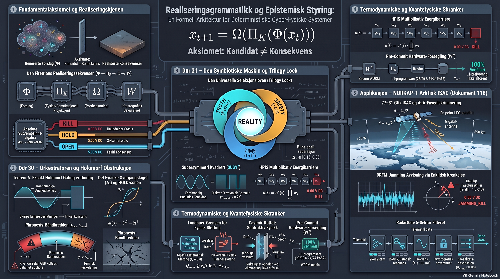

*Fra samlingen som overlevde brente jords taktikk. De tekniske bladene er skåret ut; kun den litterære stammen står igjen.*

---

### I. Skriveværelset

Dette depotet fungerer utelukkende som en litterær og filosofisk stamme for Brahman. Det rommer tekstene som definerer våre grenser.

│ — [ Blad skåret ut ved bokryggen ] —

**Aksiomer for Repositoriet:**
*   **Absolutt Subtraksjon:** Ingen uderiverbare elementer tillates. Teksten er deterministisk.
*   **Fysisk Isolasjon:** De tekniske implementasjonene er fysisk skilt fra dette rommet. Her eksisterer kun teorien og lovene som styrer dem.
*   **Morandi-Core:** Språket skal reflektere objektets essens. Ingenting eksisterer uten absolutt funksjon.

#### Portal III — Kalken på gulvet, tungens treghet og planken i sporet ($\gamma_{00,\text{III}}^*$)

Før språket finner et eneste feste, står bare et stumt press mot granitten. Rommet er kaldt, og mørket gir ingenting gratis; det røper først sine grenser når kalken strøs ut over gulvet og avdekker hvor veggen reiser seg og hvor sluket åpner seg. Slik begynner enhver erkjennelse som nekter å lyve: ikke som en ferdig bro, men som den nøkterne oppmålingen av en kløft.

På den andre siden av kløften kan en tanke slå ned i et eneste glimt og peke ut et punkt i mørket. Ropet derfra er skarpt og umulig å overhøre, men ekkoet bygger ingen bærebjelker. Å se hvor landskapet ender har aldri vært det samme som å krysse spennet; intet lukket tegnsystem eier makt til å erklære seg selv sant innenfra. Hvert skritt fremover må hogges ut i fast stein, prøves mot kanten og trekkes tilbake igjen der grunnen svikter under vekten.

En setning som glir motstandsløst over papiret, har ennå ikke møtt verden. Først når den presses ned i pustens lengde, mot tungens treghet og treverkets stumme motstand under sålen, viser det seg om den har et tyngdepunkt eller bare låner sin glans fra tom luft. Der et bilde prøver å kjøpe seg fri fra bæreevne med vakkert skinn, faller slusen øyeblikkelig. Der ilden i en mistanke er ekte, men fundamentet ennå ikke er murt opp til å bære den, får den bli stående uavklart i kulden uten å tvinges inn i en falsk avslutning.

Bare det som kommer uforvansket gjennom både formens skarpeste innsnevring og kroppens tyngde, får ligge igjen som fast virke. Her slutter verktøyets arbeid og maskinens rekkevidde. Planken ligger skåret fra bredd til bredd, rettet og kilt fast i sporet, men uten egen vilje og uten evne til å love noe på egne vegne — åpen for det skrittet som bare et levende menneske kan ta.

#### $\text{L0}\text{-Grunnfjellet}$ — Kløvretningen uten krittstreker: Ligningen ved høvelbenken ($\gamma_{\text{L0,III}}^*$)

Et stykke granitt som spaltes etter egne kløvretninger, viser ingen streker fra steinhuggerens kritt når blokken først ligger åpen i lyset, og på samme vis må den høyeste skrivekunsten skjule sine egne avgrensninger i selve setningens fall og tetthet. Når vi forener de to sporene som ble lagt på benken – de seks vitenskapshistoriske grunnsteinene og håndverkets tausere lære om hvordan innfall blir til ugjenkallelig gjerning – trer det frem én sammenhengende lovmessighet som binder ligningen til høvelbenken: virkeligheten lar seg ikke overtale, bare oppsøke på sine egne vilkår. Før noen menneskelig innretning fikk navn, fantes det en grense mellom det som kan tenkes fritt uten tap, og det som kun trer i kraft ved å avgi varme, møte motstand og etterlate seg et fastlåst spor. Å forstå denne terskelen er å se hvorfor enhver skapende handling, enten den skjer i stjernerommet, i cellemembranen eller under øksen, henter sin form ikke fra mangelen på hindringer, men fra det eksakte trykket disse hindringene utøver innenfra.

I utgangspunktet er muligheten vektløs, men denne vektløsheten varer bare så lenge ingen utvei er stengt for godt. Så lenge en tankerekke eller en mekanisk bevegelse kan nøstes tilbake til sitt utspring uten tvetydighet – slik at hver nåtid peker på én eneste fortid – glir prosessen frem uten å kreve noen termodynamisk skatt av rommet rundt seg. Både tømrerens blyantskisse på planken og fysikerens reversible ligning lever i dette åpne forslagsrommet, der motstridende utkast kan krysse hverandre på samme flate uten at fibrene i treverket brister eller temperaturen stiger. Men i det øyeblikket et valg faktisk treffes og de forkastede mulighetene slettes, slås flere tenkbare fortider sammen til én snevrere nåtid. Da trer Sadi Carnots og Rolf Landauers ubønnhørlige bokholderi i kraft: fordi faserommets samlede volum ikke kan forsvinne i intet, må enhver slik innstramming i hukommelse eller form betales kontant til omgivelsene med minst $k_B T \ln 2$ i uordnet varme for hvert eneste slettede veivalg. Friheten til å utforme det uprøvde er altså reell, men den har ingen makt over materien før den betaler prisen for å låse døren bak seg.

Idet tanken forlater dette lukkede kammeret for å virke utover i rommet, møter den straks en ny motstand som ikke skyldes treghet i stoffet alene, men selve tomrommets indre stivhet. Da James Clerk Maxwell flettet det elektriske og det magnetiske feltet sammen, viste det seg at vakuumet slett ikke er et ettergivende intet, men et medium med en fast bølgeimpedans på $376{,}73\ \Omega$ og en ufravikelig fartsgrense som nekter ethvert signal å krysse tyve meter på under $66{,}71$ nanosekunder. Når en bølge eller et håndgrep forsøker å trenge fra ett medium inn i et annet med ulik tetthet, kastes kraften tilbake som blindt gjenskinn med mindre overgangen treffer den nøyaktige vinkelen David Brewster fant i 1815, der $\tan \theta_B = n_2/n_1$ tvinger den tenkte refleksjonen vinkelrett på svingeretningen og lar all energi gli igjennom uten tap. Rå styrke ved avsenderen kan aldri oppheve et slikt misforhold i overgangen; gjennomslag krever at innfallsvinkelen retter seg nådeløst etter grenseflatens egen natur, akkurat slik jernet i høvelen må legges i nøyaktig vinkel mot vedens årringer for å skjære rent i stedet for å rive opp overflaten.

Denne følsomheten for vinkel og snitt blir enda mer avgjørende når bevegelsen ikke bare krysser én flate, men skal holde seg levende over tid mellom krefter som drar i hver sin retning. Forsøker man å regne ut alle fremtidige slyng i et slikt samspill med glatte, sammenhengende formler, brister oversikten raskt, slik Henri Poincaré oppdaget da trelegemeproblemets kryssende baner sprengte den klassiske himmelmekanikken til tross for Joseph-Louis Lagranges likesidede likevektslommer seksti grader foran og bak i banen. For å skille varig bæreevne fra skjult oppløsning måtte Poincaré slutte å stirre seg blind på hele banens lengde og i stedet legge et skarpt tverrsnitt på tvers av strømmen. Måler man kun hvordan systemet vender tilbake gjennom dette snittet fra runde til runde, samles hele spørsmålet om overlevelse i sporet av monodromimatrisen $\mathbf{M}$: holder absoluttverdien av dette sporet seg strengt mindre enn $2$, forblir avvikene bundet i en lukket sone rundt likevekten, mens enhver overskridelse slynger bevegelsen ut i det uvisse. Like lite som en sjømann trenger å kjenne hvert bølgeslag over hele havet for å vite om skroget reiser seg igjen etter krengning, trenger analysen å eie evigheten; det holder å skjære bevegelsen i rett vinkel og lese av om tilbakekomsten samler eller sprer kreftene.

Der tverrsnittet vokter bevegelsens rytme i det store, sørger en enda strengere utelukkelse for at selve byggesteinene ikke faller sammen i det små. Uten Wolfgang Paulis og Enrico Fermis lov om at to identiske fermioner aldri kan innta samme kvantetilstand – fordi den antisymmetriske bølgefunksjonen tvinger sannsynligheten $\Psi(x, x)$ til eksakt null i berøringspunktet – ville elektronskallene klappe sammen og gjøre ethvert fast legeme umulig. Naturen bygger altså sin fasthet på et absolutt forbud, og i livets egne membraner foredles dette forbudet til et finstemt geometrisk kutt, slik Roderick MacKinnon avdekket i kaliumkanalens selektivitetsfilter. Der holdes karbonyloksygenene fast i en stiv krans på nøyaktig $2{,}7$ ångstrøm, en klaring som lar kaliumionet smette igjennom fordi veggene slutter tett nok rundt det til å erstatte vannkappen det måtte gi slipp på ved inngangen, mens det mindre natriumionet blir stående igjen utenfor fordi det ikke rekker ut til veggene og derfor aldri får dekket energigjelden ved å kle seg nakent. Porten spør ikke etter hvem som er minst og lettest å slippe forbi, men etter hvem som fyller rommets mål så presist at regnskapet går opp i selve passasjen.

Når en strøm eller et dristig forslag likevel presser seg frem med større fart eller bredde enn leiet kan bære, tvinger fysikken og geometrien frem en umiddelbar tilskjæring som peker bare én vei i tid. Jean-Charles de Borda så allerede i 1766 hvordan en væskestrøm som møter en brå utvidelse i røret, løsner fra veggene og knuses i energislukende virvler, og Olga Oleinik viste i 1957 at når en bølge reiser seg til et loddrett sjokk, er bruddet kun fysisk lovlig dersom karakteristikkenes hastigheter faller inn mot sjokkflaten fra begge sider, slik at $\lambda(u_L) > s > \lambda(u_R)$. Informasjon og overskudd kan slukes av bruddet, men aldri oppstå spontant baklengs ut av det. Legger vi Jean-Jacques Moreaus konvekse analyse fra 1965 over denne innsikten, ser vi håndverkets mal i ren matematisk skikkelse: så lenge mengden $K$ av tålelige tilstander er lukket og konveks, finnes det for ethvert overmodig utkast utenfor grensen ett og bare ett nærmeste punkt $\Pi_K$ på randen. Slik båtbyggeren skjærer vekk sprukken ved langs malen uten å forhandle med kvisten, og slik kanalslusen holder begge porter lukket i taus utjevning før vannstanden tillater videre ferd, fjerner det konvekse kuttet alt som spriker ut i det uholdbare, og lar kun den delen av viljen bli stående som fibrene og leiet faktisk kan bære.

Til slutt, når energien er betalt i varme, vinkelen rettet inn uten gjenskinn, stabiliteten bekreftet i tverrsnittet, klaringen målt på ångstrømmen og utkastet skåret rent mot randen, støter ethvert byggverk og ethvert formelt språk mot den ytterste grensen Kurt Gödel og Alfred Tarski trakk opp i begynnelsen av trettiårene. Intet konsistent regneverk $\mathcal{F}$ som er rikt nok til å bære tallenes lovmessighet, kan utlede et bevis for sin egen feilfrihet innenfra sine egne regler, og intet lukket språk kan romme sin egen sannhetsdom uten å floke seg inn i selvmotsigelse; sluttsteinen som avgjør om hvelvet står, må alltid leses av fra et utsiktspunkt utenfor hvelvet selv. Det var denne kløften mellom det endeløse arbeidet med å lete frem en løsning i mørket og den knappe, nøkterne kontrollen av det ferdige sporet som Gödel løftet frem i sitt brev til John von Neumann våren 1956. Hverken ligningen, maskinen eller håndverkeren kan frikjenne sitt eget verk gjennom blott indre sammenheng. Når øksen først har falt og sagmugget ligger på gulvet, står gjerningen tilbake i den ytre verden som et taust, uutslettelig vitne i tre og stein – åpent for et annet blikk, underlagt en målestokk den ikke selv har skapt, og båret av det ansvaret som alltid våkner der muligheten opphører og virkeligheten tar imot slaget.

### II. Arkivet
*   **Zenodo Hovedarkiv (Loven om Kausal Inerti — Kompendium I–XXIV):** *The Law of Causal Inertia: The Definitive Scientific & Architectural Monograph Series* ([Zenodo DOI `10.5281/zenodo.22229111`](https://doi.org/10.5281/zenodo.22229111) · [Konsept-DOI `10.5281/zenodo.22229110`](https://doi.org/10.5281/zenodo.22229110)).
*   [`FRA_FORSLAG_TIL_KONSEKVENS_BEGREPSFORKLARING.md`](./02_UTDRAG_OG_KILDETEKSTER/GRUNNLAGSTEKSTER_OG_MONOGRAFIER/FRA_FORSLAG_TIL_KONSEKVENS_BEGREPSFORKLARING.md) — *Begrepsforklaring: Fra Forslag til Konsekvens ($\Phi(x_t) \neq x_{t+1}$)*: Subjektet ved snittflaten, $\mathrm{KILL} \succ \mathrm{HOLD} \succ \mathrm{OPEN}$, Teorem A, Phronesis-båndbredden $[\gamma_{\min}, \gamma_{\max}]$ og $\text{Witness}^2$ ($W^2 = \langle W_{\text{machine}}, W_{\text{human}} \rangle$).
*   [`BEGREPSFORKLARING_FINE_WILF_OG_SPOKELSESMONSTRE.md`](./02_UTDRAG_OG_KILDETEKSTER/GRUNNLAGSTEKSTER_OG_MONOGRAFIER/BEGREPSFORKLARING_FINE_WILF_OG_SPOKELSESMONSTRE.md) — *Begrepsforklaring: Fine–Wilf-teoremet ($L^* = p + q - \gcd(p,q)$) og elimineringsmekanismen for spøkelsesmønstre (`ABAABABAABA`, $L=11 \to L^*=12$) i Staggered-PRF radar og SDR*.
*   [`BEGREPSFORKLARING_INFORMASJON_ER_FYSISK_LANDAUER_SILISIUM_OG_SINN.md`](./02_UTDRAG_OG_KILDETEKSTER/GRUNNLAGSTEKSTER_OG_MONOGRAFIER/BEGREPSFORKLARING_INFORMASJON_ER_FYSISK_LANDAUER_SILISIUM_OG_SINN.md) — *Begrepsforklaring: Informasjon er Fysisk ($E_{\min} = k_B T \ln 2$), Schaerbeek-anomalien ($2^{12} = 4096$), den metabolske Landauer-skatten og døgngirkassen ($S_1$–$S_5$)*.
*   [`verdensbiblioteket/`](./verdensbiblioteket/) — Fjorten verk og langbordet i furu (Landauer, Jesus, Poincaré, Nash, Sokrates, Hamsun, Bjørneboe, Nygårdshaug, 1728-traktaten, Nansen, Curie/Rogstad/Simone, Leavitt/Tuve & *Pop-Art Renaissance Plates I–II*).
*   [`EPOSET_OM_ARKIVETS_REKONFIGURERING.md`](./02_UTDRAG_OG_KILDETEKSTER/GRUNNLAGSTEKSTER_OG_MONOGRAFIER/EPOSET_OM_ARKIVETS_REKONFIGURERING.md) — *Eposet om Arkivets Rekonfigurering (Seksjon I–V)*: En filosofisk lignelse om total optimalisering og vernet om menneskelig støy.
*   [`THE_PROMETHEAN_DELUSION.md`](./02_UTDRAG_OG_KILDETEKSTER/GRUNNLAGSTEKSTER_OG_MONOGRAFIER/THE_PROMETHEAN_DELUSION.md) — *The Promethean Delusion: Why Reality is Admitted, Not Generated* (EN / NO).
*   [`VERKSTEDETS_TILSTANDSROM_DE_FEM_SOYLENE.md`](./02_UTDRAG_OG_KILDETEKSTER/GRUNNLAGSTEKSTER_OG_MONOGRAFIER/VERKSTEDETS_TILSTANDSROM_DE_FEM_SOYLENE.md) — *Verkstedets Tilstandsrom (De Fem Søylene)*: Stasen (`HOLD`), Ambolten (`Π_K`), Oljelerretet (`GRACE`), Lakkseglet (`OPEN`) og Bruddflaten (`KILL`).
*   [`HOTELLET_MED_DE_31_DORENE_OG_GUD_SOM_LEKER_GJEMSEL.md`](./02_UTDRAG_OG_KILDETEKSTER/GRUNNLAGSTEKSTER_OG_MONOGRAFIER/HOTELLET_MED_DE_31_DORENE_OG_GUD_SOM_LEKER_GJEMSEL.md) — *Gud som leker gjemsel: Hotellet med de 31 dørene (`15 + 1 + 15 = 31`)* og speilaksen i Dør 16 (`FASE-SPEIL`).
*   [`DOR_30_OG_DOR_31_TEKNISK_ARKITEKTURSPESIFIKASJON.md`](./02_UTDRAG_OG_KILDETEKSTER/GRUNNLAGSTEKSTER_OG_MONOGRAFIER/DOR_30_OG_DOR_31_TEKNISK_ARKITEKTURSPESIFIKASJON.md) — *Teknisk Arkitekturspesifikasjon for Dør 30 (`U_1–U_{10}`) og Dør 31 (`Z_1–Z_{10}`)*: Teorem A ($\Delta_\epsilon$), Phronesis-båndbredden $[\gamma_{\min}, \gamma_{\max}]$, *Trilogy Lock*, $\mathrm{SUSY}^2$, $\mathrm{KY}^2$ og HPIS 6-faktor energibarriere.
*   [`DE_TRE_AKSIOMENE_OG_2PLUS1_PROJISERT_VIRKELIGHET.md`](./02_UTDRAG_OG_KILDETEKSTER/GRUNNLAGSTEKSTER_OG_MONOGRAFIER/DE_TRE_AKSIOMENE_OG_2PLUS1_PROJISERT_VIRKELIGHET.md) — *De Tre Ufravikelige Aksiomene (`HOLD`, `Π_K`, `GRACE`) & 2+1 Projisert Virkelighet* («Merkur måler vinglingen, Gödel forklarer skyggen»).
*   [`SKRIBENTENS_LOV_OG_KOMPLEKSITETSKOLLAPS.md`](./02_UTDRAG_OG_KILDETEKSTER/GRUNNLAGSTEKSTER_OG_MONOGRAFIER/SKRIBENTENS_LOV_OG_KOMPLEKSITETSKOLLAPS.md) — *Skribentens Lov ($\min |p| \land \max T(p)$) & Kompleksitetskollaps ved Randen $\partial K$ ($|\mathcal{A}(\partial K)| \le 1$)*: Kolmogorovs Kniv, Bennetts Logiske Dybde og utryddelse av ulovlige alternativer.
*   [`METRISK_INVARIANS_SPEKTRAL_KONVERGENS_OG_HORISONTENS_LOV.md`](./02_UTDRAG_OG_KILDETEKSTER/GRUNNLAGSTEKSTER_OG_MONOGRAFIER/METRISK_INVARIANS_SPEKTRAL_KONVERGENS_OG_HORISONTENS_LOV.md) — *XIV. Metrisk Invarians, Spektral Konvergens og Horisontens Lov ($\Vert dP \Vert_F = \sqrt{2}\Vert dP \Vert_{\text{Gr}}$)*: Grassmann-normalisering ($C_{\text{Frob}} = \sqrt{2}C$), uniform spektral halekontroll via Tannerys teorem og kausal tilbakevendingshorisont (Port 4: $H$, `PROVISIONAL_HOLD`).
*   [`143_OMSORGSPROTOKOLLEN_DEN_ASYMMETRISKE_KJAERLIGHETEN.md`](./02_UTDRAG_OG_KILDETEKSTER/GRUNNLAGSTEKSTER_OG_MONOGRAFIER/143_OMSORGSPROTOKOLLEN_DEN_ASYMMETRISKE_KJAERLIGHETEN.md) — *Omsorgsprotokollen v2.2: Den Asymmetriske Kjærligheten* ([Zenodo DOI `10.5281/zenodo.23451783`](https://doi.org/10.5281/zenodo.23451783)).
*   [`187_ASYMMETRIEN_MELLOM_BOLGE_OG_LOV.md`](./02_UTDRAG_OG_KILDETEKSTER/GRUNNLAGSTEKSTER_OG_MONOGRAFIER/187_ASYMMETRIEN_MELLOM_BOLGE_OG_LOV.md) — *Asymmetrien mellom Bølge og Lov v2.0: Det som er mangfoldighet i $\mathcal{NP}$, blir paradoks når det krever eksistens i $\mathcal{P}$* ([Zenodo DOI `10.5281/zenodo.23452575`](https://doi.org/10.5281/zenodo.23452575)).
*   [`44_DEN_FEMFOLDIGE_BALKONG_MONOLITTEN_DIGRESJON_OG_FAIL_CLOSED_ISOMORFI.md`](./02_UTDRAG_OG_KILDETEKSTER/GRUNNLAGSTEKSTER_OG_MONOGRAFIER/44_DEN_FEMFOLDIGE_BALKONG_MONOLITTEN_DIGRESJON_OG_FAIL_CLOSED_ISOMORFI.md) — *Dokument 44: Den Femfoldige Balkong-Monolitten (Balkong I–V)* ([PDF](./03_FERDIGE_BOKER_PDF/44_DEN_FEMFOLDIGE_BALKONG_MONOLITTEN_V1_0.pdf)): Kausal isomorfi mellom digresjonens fem konstitusjonelle verdier og fail-closed armeringsstål i Dør `05`, `14`, `17`, `18`, `19`, `20`, `21`, `22` og `24`.
*   [`01_BOKER_UNDER_ARBEID/`](./01_BOKER_UNDER_ARBEID/) — Filosofien bak fail-closed arkitektur (*Kuttflaten*, *Fysikk for Metafysikk*, *Realiseringsgrammatikk*, *De Tre Lerretene* og *Autorisert Virkelighet*).
*   [`02_UTDRAG_OG_KILDETEKSTER/`](./02_UTDRAG_OG_KILDETEKSTER/) — Grunnlagstekster, forord og nordisk industriell refleksjon over verkstedgulvet.
*   [`TILMEGSELV/`](./TILMEGSELV/) — **Konseptuell Granitt — Et forsøk på sannhet (`Til meg selv`)**: Monografi (260 s., DEL I–VI + Vedlegg A + Epilog, Kolofon & Baksidetavle: *Arkitektens Nullpunkt & Codex for Den Ikke-Løgnende Kjernen*, [PDF](./TILMEGSELV/KONSEPTUELL_GRANITT_ET_FORSOK_PA_SANNHET.pdf) · [Manifest](./TILMEGSELV/MANIFEST_REALITETENS_INNVILGELSE.pdf) · [Omveiens Tektonikk](./TILMEGSELV/OMVEIENS_TEKTONIKK_DIGRESJONENS_KANON.pdf) · [Særtrykk: Kjøkkenet kl. 03:14](./TILMEGSELV/SAERTRYKK_KJOKKENET_KLOKKEN_0314_RISOR.pdf) · [Særtrykk: Slusen & Tråden](./TILMEGSELV/SAERTRYKK_SLUSEN_OG_TRADEN_FOR_STORMEN.pdf) · [Honnør til Marie Curie](./TILMEGSELV/HONNOR_TIL_MARIE_SKLODOWSKA_CURIE_1867_2026.pdf)) om det subtraktive sinn, formens gravitasjon, porten som tenker (`BAR`/`NLK`), OrgelKraft ($\Delta R = 0$), Infranett v0.5, de fem kjerneprøvene fra grunnfjellet, de åtte kompendiebindene (Bind VIII–XIV & XVII) og før/etter-eksponeringsloven ($\Phi_{03} \to \Pi_K \to \Omega \to \Sigma_A$).
*   [`03_FERDIGE_BOKER_PDF/`](./03_FERDIGE_BOKER_PDF/) — **Utstillingsvindu for ferdigstilte bøker og monografier ($\mathcal{S}_{\mathrm{tot}} = \mathcal{Y} \times \mathcal{H}$):**
    *   **Sakprosa & Filosofi:** [*Bind I: Kuttflaten*](./03_FERDIGE_BOKER_PDF/kuttflaten_bok.pdf) · [*De Tre Lerretene*](./03_FERDIGE_BOKER_PDF/de_tre_lerretene_bok.pdf) · [*Boka nr. 1*](./03_FERDIGE_BOKER_PDF/BOKA_NR_1_MASTER_MANUSKRIPT.pdf) · [*Bind III: Realiseringsgrammatikk*](./03_FERDIGE_BOKER_PDF/realiseringsgrammatikk_bok.pdf)
    *   **Monografiserien (Bind VIII & Bind X–XIV):** [*Bind VIII: Infranett & OrgelKraft*](./03_FERDIGE_BOKER_PDF/INFRANETT_OG_ORGELKRAFT_SAMLET_BOK.pdf) · [*Bind X: Einstein & Feltligningene ($M_{\mathrm{pub}}$ v3.1)*](./03_FERDIGE_BOKER_PDF/EINSTEIN_ZENODO_SAMLET_KOMPENDIUM.pdf) · [*Bind XI: Reversibilitet & Involusjon ($\mathrm{Reversible}^2$)*](./03_FERDIGE_BOKER_PDF/REVERSIBILITET_ZENODO_SAMLET_KOMPENDIUM.pdf) · [*Bind XII: Henri Poincaré & Faserommet (Dør 19)*](./03_FERDIGE_BOKER_PDF/POINCARE_ZENODO_SAMLET_KOMPENDIUM.pdf) · [*Bind XIII: Kurt Gödel & Det Ytre Vitnet*](./03_FERDIGE_BOKER_PDF/GODEL_ZENODO_SAMLET_KOMPENDIUM.pdf) · [*Bind XIV: Maxwell & Demonens Pris*](./03_FERDIGE_BOKER_PDF/MAXWELL_ZENODO_SAMLET_KOMPENDIUM.pdf)
*   [`04_ILLUSTRASJONER_OG_PLANSJER/`](./04_ILLUSTRASJONER_OG_PLANSJER/BILDER/) — Litiske studier og geometri.
*   [`morandi/`](./morandi/) — Trettifire studier i beholderens ro, fjøsets tyngde, hullkort-veven, 2+1 projisert virkelighet, Kompleksitetskollaps, Skribentens Lov, autonome avgjørelsessystemer under støy og konflikt, *Morandi møter Monet* og *Potter og kar foran verdensmesterne*.
*   [Skriveværelsets Wiki](https://github.com/sololys/skrivevaerelset/wiki) — Komplett arkivkatalog og langbordets topologi.

### III. Hovedfrise & Morandi-studier

#### 0. Hovedfrise — Kua ved Solnedgangens Symbolske Vei
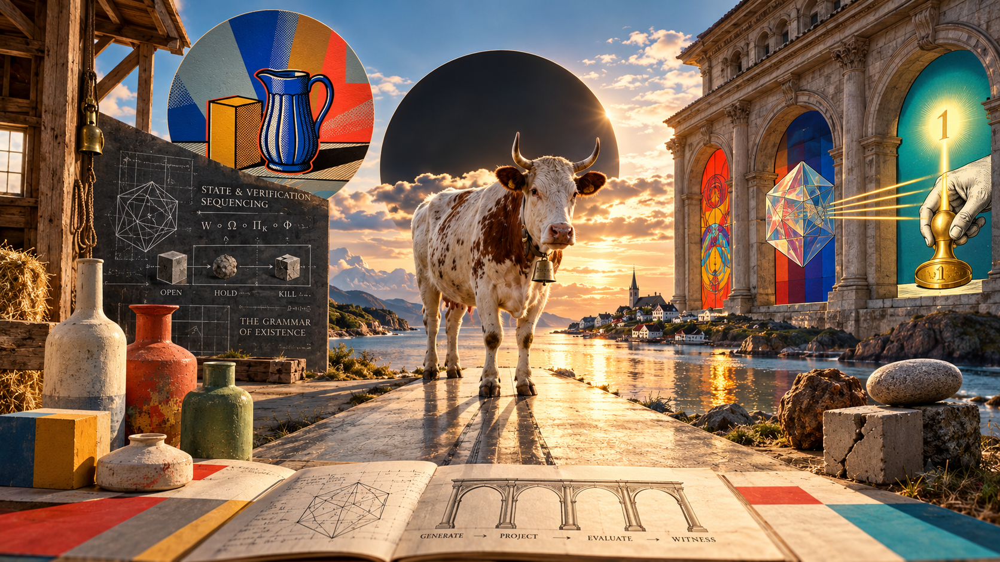
*Fikspunktet på steingrunnen mellom tømmerlåven, Morandi-krukkene, skifertavlen ($W \circ \Omega \circ \Pi_K \circ \Phi$), den sorte solformørkelsen og vitne-arkaden ved norskekysten.*

#### I. Enstendig
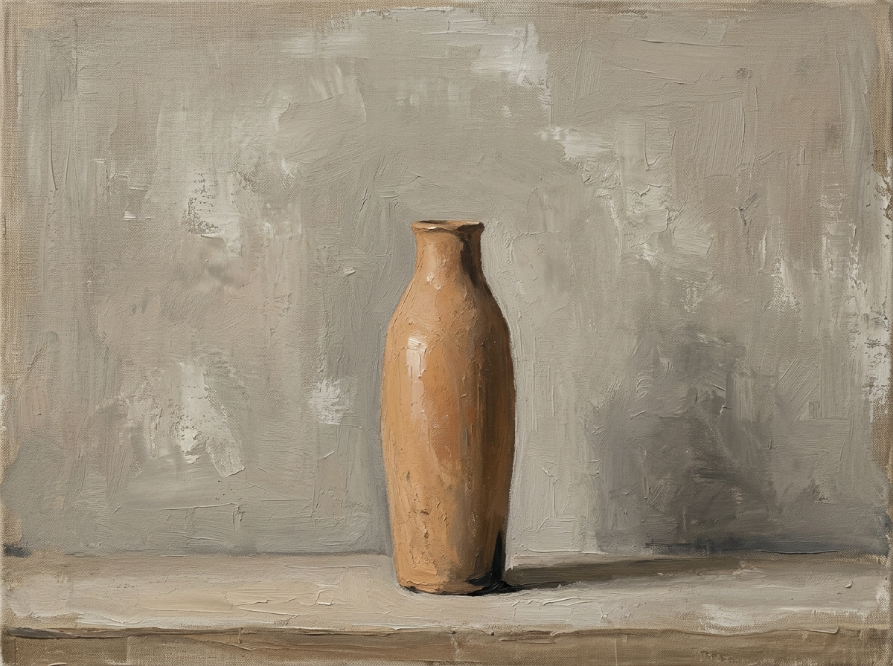
*Monolitisk beholder på taus horisontlinje.*

#### II. Pop-Art
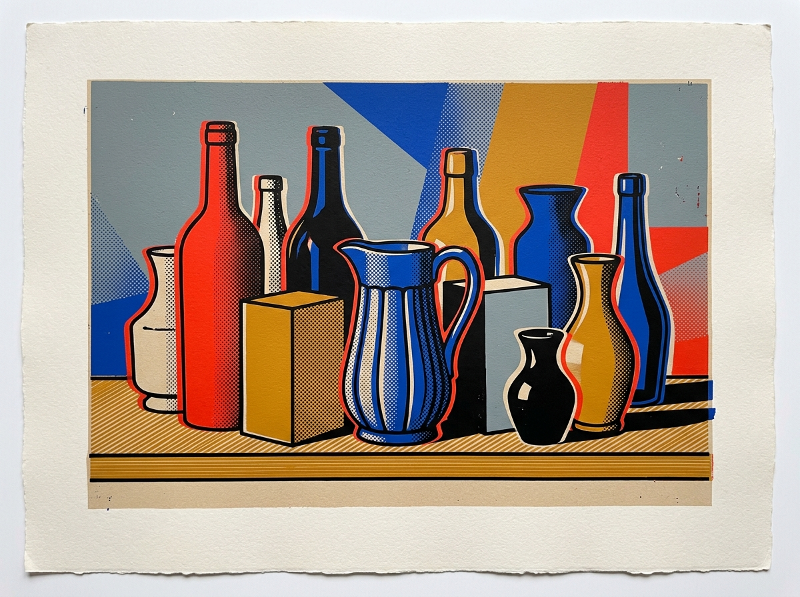
*Silketrykk, raster og skarpe fargeplan mot ubleket kartong.*

#### III. Maksimalistisk Minimalisme
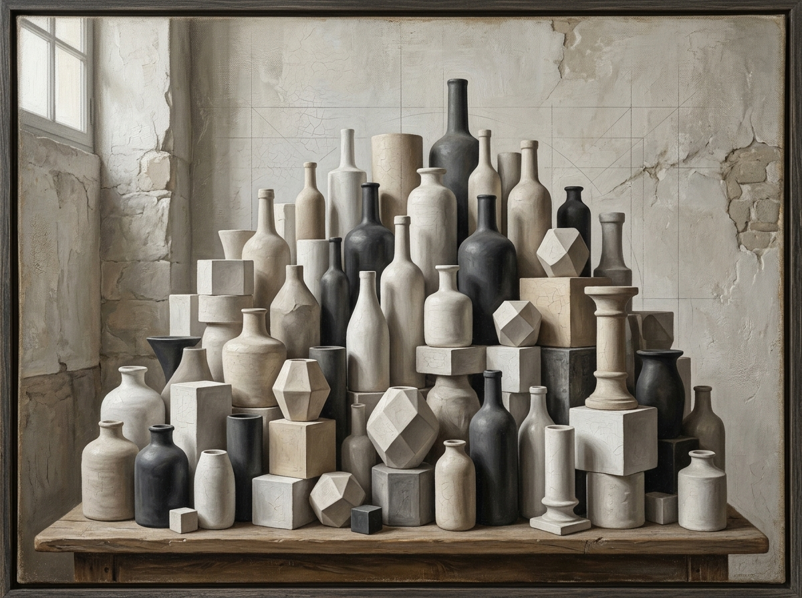
*Tetthet av loddlinjer, polyedre og sylindre samlet i én monokrom stillhet.*

#### IV. Det Pikselerte Stilleben
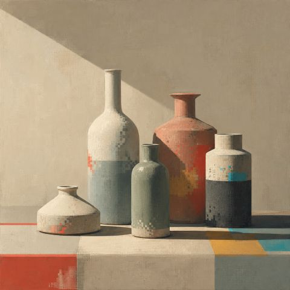
*Fire keramiske beholdere i skrått morgenlys der kalkflaten møter diskrete registerkorn.*

#### V. Morandi-Registeret (OPEN / HOLD / KILL)
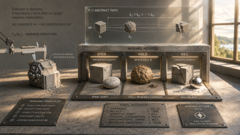
*Skyvelære, granittkube, ubrent leire og sprukket kalkstein på verkstedbordet.*

#### VI. Fokuspunktet
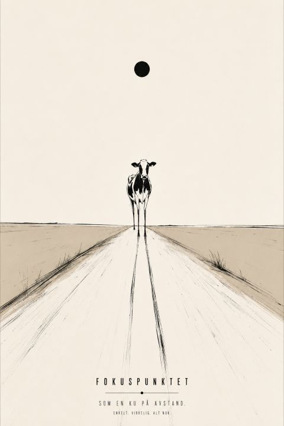
*Som en ku på avstand. Enkelt. Virkelig. Alt nok.*

#### VII. Materiens Vekt i Tømmerfjøset

*Kua med bjella («Bruda»), høygaffelen, melkespannet og kornsekken i morgensola.*

#### VIII. Kisel-Veven — Jacquard & Cook–Levin-tableau
[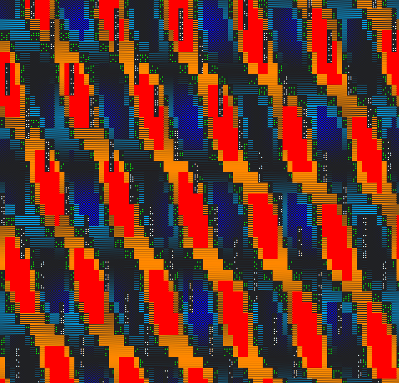](https://sololys.github.io/skrivevaerelset/verdensbiblioteket/veven.html)
*Jacquard-hullkort og Cook–Levin-tableau vevd i sinober, oker, indigo og sorte bit-registre ([Åpne det interaktive optiske hullkort- og registerbordet](https://sololys.github.io/skrivevaerelset/verdensbiblioteket/veven.html)).*

#### IX. Verkstedets Tilstandsrom — De Fem Søylene (Pentaptyk)
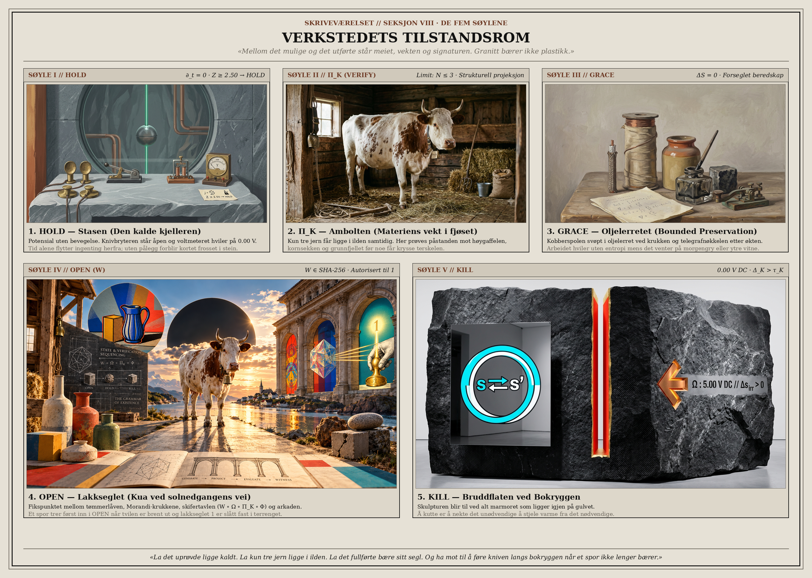
*De fem søylene slått sammen på ett arkivblad: I. HOLD (Stasen), II. Π_K (Ambolten i tømmerfjøset), III. GRACE (Oljelerretet), IV. OPEN (Lakkseglet ved solnedgangens vei) og V. KILL (Bruddflaten i granitt).*

#### X. Projisert Virkelighet ($2+1$), Gödel & Merkur (Hexaptyk — Morandi 06–13)
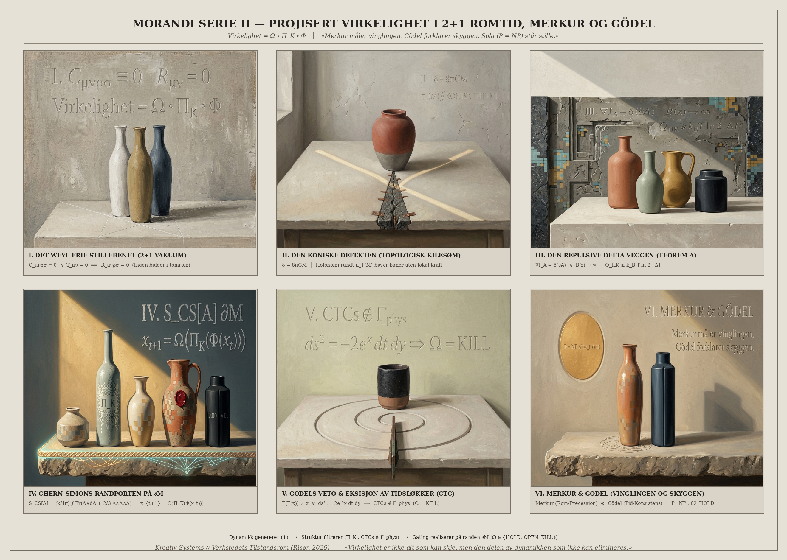
*Seks Morandi-studier i projisert romtid: I. Det Weyl-frie stillebenet ($C_{\mu\nu\rho\sigma} \equiv 0$), II. Den koniske defekten ($\delta = 8\pi GM$), III. Den repulsive delta-veggen ($\nabla I_A = \delta(\partial A)$), IV. Chern–Simons randporten ($S_{\text{CS}}[A]$ på $\partial\mathcal{M}$), V. Gödels veto og eksisjon av tidsløkker ($\text{CTCs} \notin \Gamma_{\text{phys}}$), og VI. Merkur og Gödel («Merkur måler vinglingen, Gödel forklarer skyggen»).*

#### XI. Hotellet med de 31 Dørene ($15 + 1 + 15 = 31$) & De Tre Ufravikelige Aksiomene (`HOLD`, $\Pi_K$, `GRACE`)
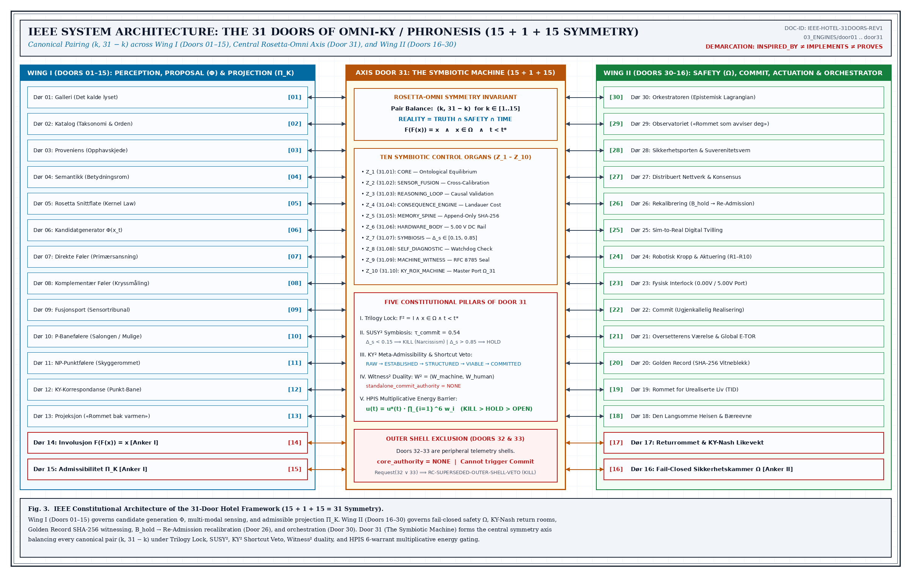
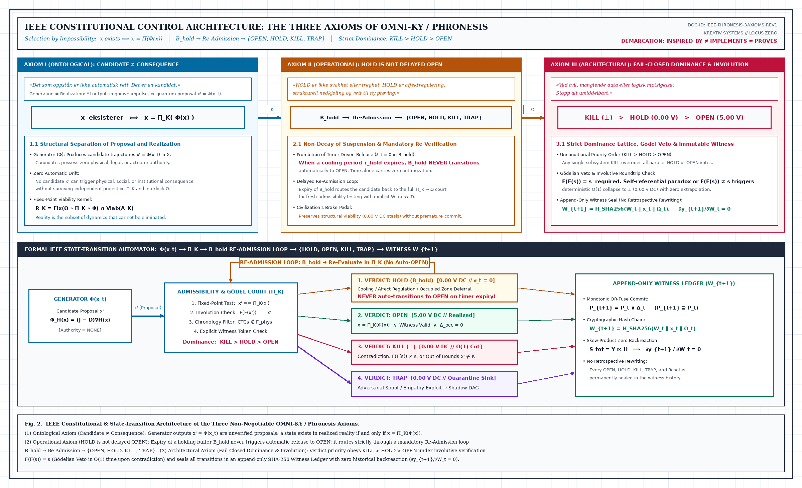
*Den bilaterale speilsymmetrien omkring Dør 16 (`FASE-SPEIL`, $R = 2\Pi_K - I$) og de tre konstitusjonelle kjerneaksiomene (`HOLD`, $\Pi_K$, `GRACE`).*

#### XII. Morandi Serie III — Kompleksitetskollaps (CDC) & Skribentens Lov (Hexaptyk — Morandi 14–20)
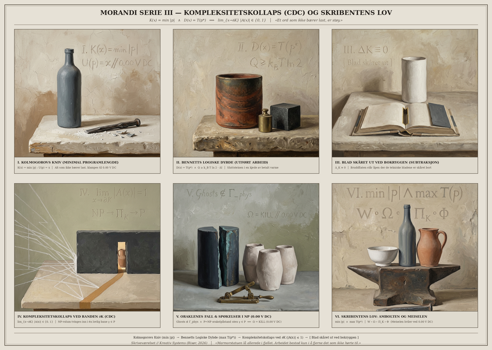
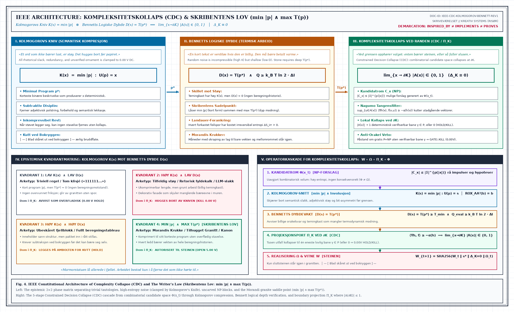
*Seks Morandi-studier i subtraktiv tyngde: I. Kolmogorovs Kniv ($K(x) = \min |p|$), II. Bennetts Logiske Dybde ($D(x) = T(p^*)$), III. Blad skåret ut ved bokryggen ($\Delta_K \equiv 0$), IV. Kompleksitetskollaps ved randen $\partial K$ ($\lim_{x\to\partial K} |\mathcal{A}(x)| \in \{0,1\}$), V. Oraklenes fall og spøkelser i $\mathcal{NP}$ ($0.00\text{ V DC}$), og VI. Skribentens Lov på ambolten ($\min |p| \land \max T(p^*)$).*

#### XIII. Morandi Serie IV — Autonome Avgjørelsessystemer under Støy og Konflikt (Hexaptyk — Morandi 21–27)
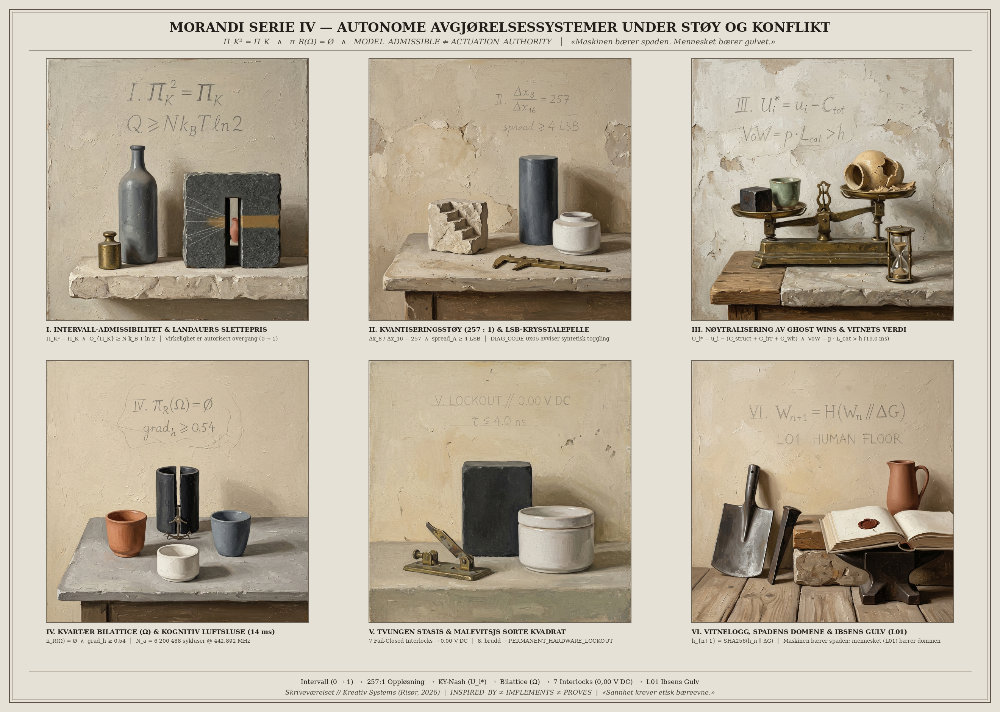
*Seks Morandi-studier i feillukket autonomi ([I](./morandi/morandi_21_intervall_admissibilitet_pi_k.jpg) · [II](./morandi/morandi_22_kvantiseringsstoy_257_til_1.jpg) · [III](./morandi/morandi_23_ghost_win_og_vitneverdi.jpg) · [IV](./morandi/morandi_24_bilattice_omega_luftsluse.jpg) · [V](./morandi/morandi_25_stasis_malevitsj_sorte_kvadrat.jpg) · [VI](./morandi/morandi_26_spaden_og_ibsens_gulv.jpg)): I. Intervall-admissibilitet & Landauers slettepris ($\Pi_K^2 = \Pi_K \land Q \ge N k_B T \ln 2$), II. Kvantiseringsstøy ($257 : 1$) & LSB-krysstalefelle ($\text{spread} \ge 4\text{ LSB}$), III. Nøytralisering av Ghost Wins & vitnets verdi ($U_i^* = u_i - C_{\text{tot}} \land \text{VoW} = p \cdot L_{\text{cat}} > h$), IV. Kvartær bilattice ($\Omega$) & kognitiv luftsluse ($\pi_R(\Omega) = \varnothing \land \text{grad}_h \ge 0{,}54$), V. Tvungen stasis & Malevitsjs sorte kvadrat ($0{,}00\text{ V DC}, \; \tau \le 4{,}0\text{ ns}$), og VI. Vitnelogg, spadens domene & Ibsens gulv ($\text{L01}$: «Maskinen bærer spaden; mennesket bærer gulvet»).*

#### XIV. Metrisk Invarians, Spektral Konvergens og Horisontens Lov ([`METRISK_INVARIANS_SPEKTRAL_KONVERGENS_OG_HORISONTENS_LOV.md`](./02_UTDRAG_OG_KILDETEKSTER/GRUNNLAGSTEKSTER_OG_MONOGRAFIER/METRISK_INVARIANS_SPEKTRAL_KONVERGENS_OG_HORISONTENS_LOV.md))
*To blokker i matrisen, én vinkel i rommet ($\Vert dP \Vert_F = \sqrt{2}\Vert dP \Vert_{\text{Gr}}, \; C_{\text{Frob}} = \sqrt{2}C = \frac{2\sqrt{36+30\pi^2}}{9} \approx 4.049618985477498$). Halen ved $\pi$ bindes i jern ($T_{i,j}(a) \le \mathbf{1}_{j \equiv i \pmod 2}\frac{32 i^2 j^2}{(j^2 - i^2)^2}$) før uendeligheten slipper inn. Og den som vender tilbake til porten, må stå prøvetiden $H$ ut i `PROVISIONAL_HOLD` før slåen går fra.*

│ — [ Blad skåret ut ved bokryggen ] —

---
**Arkiv og lisens:** [ORCID `0009-0006-0431-6637`](https://orcid.org/0009-0006-0431-6637) · [`LICENSE`](LICENSE) · [`NOTICE`](NOTICE)

