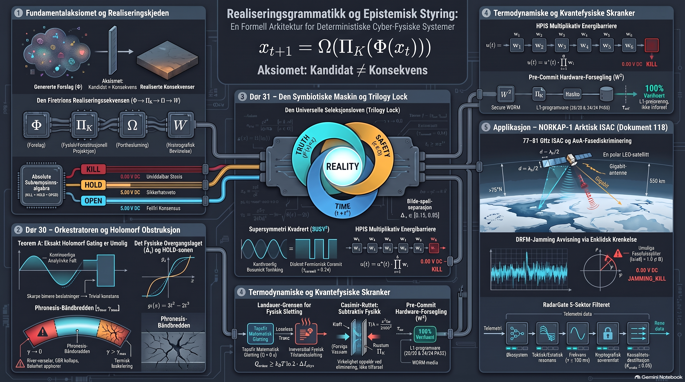

*Fra samlingen som overlevde brente jords taktikk. De tekniske bladene er skåret ut; kun den litterære stammen står igjen.*

---

### I. Skriveværelset

Dette depotet fungerer utelukkende som en litterær og filosofisk stamme for Brahman. Det rommer tekstene som definerer våre grenser.

│ — [ Blad skåret ut ved bokryggen ] —

**Aksiomer for Repositoriet:**
*   **Absolutt Subtraksjon:** Ingen uderiverbare elementer tillates. Teksten er deterministisk.
*   **Fysisk Isolasjon:** De tekniske implementasjonene er fysisk skilt fra dette rommet. Her eksisterer kun teorien og lovene som styrer dem.
*   **Morandi-Core:** Språket skal reflektere objektets essens. Ingenting eksisterer uten absolutt funksjon.

### II. Arkivet
*   **Zenodo Hovedarkiv (Loven om Kausal Inerti — Kompendium I–XXIV):** *The Law of Causal Inertia: The Definitive Scientific & Architectural Monograph Series* ([Zenodo DOI `10.5281/zenodo.22229111`](https://doi.org/10.5281/zenodo.22229111) · [Konsept-DOI `10.5281/zenodo.22229110`](https://doi.org/10.5281/zenodo.22229110)).
*   [`FRA_FORSLAG_TIL_KONSEKVENS_BEGREPSFORKLARING.md`](./02_UTDRAG_OG_KILDETEKSTER/GRUNNLAGSTEKSTER_OG_MONOGRAFIER/FRA_FORSLAG_TIL_KONSEKVENS_BEGREPSFORKLARING.md) — *Begrepsforklaring: Fra Forslag til Konsekvens ($\Phi(x_t) \neq x_{t+1}$)*: Subjektet ved snittflaten, $\mathrm{KILL} \succ \mathrm{HOLD} \succ \mathrm{OPEN}$, Teorem A, Phronesis-båndbredden $[\gamma_{\min}, \gamma_{\max}]$ og $\text{Witness}^2$ ($W^2 = \langle W_{\text{machine}}, W_{\text{human}} \rangle$).
*   [`BEGREPSFORKLARING_FINE_WILF_OG_SPOKELSESMONSTRE.md`](./02_UTDRAG_OG_KILDETEKSTER/GRUNNLAGSTEKSTER_OG_MONOGRAFIER/BEGREPSFORKLARING_FINE_WILF_OG_SPOKELSESMONSTRE.md) — *Begrepsforklaring: Fine–Wilf-teoremet ($L^* = p + q - \gcd(p,q)$) og elimineringsmekanismen for spøkelsesmønstre (`ABAABABAABA`, $L=11 \to L^*=12$) i Staggered-PRF radar og SDR*.
*   [`BEGREPSFORKLARING_INFORMASJON_ER_FYSISK_LANDAUER_SILISIUM_OG_SINN.md`](./02_UTDRAG_OG_KILDETEKSTER/GRUNNLAGSTEKSTER_OG_MONOGRAFIER/BEGREPSFORKLARING_INFORMASJON_ER_FYSISK_LANDAUER_SILISIUM_OG_SINN.md) — *Begrepsforklaring: Informasjon er Fysisk ($E_{\min} = k_B T \ln 2$), Schaerbeek-anomalien ($2^{12} = 4096$), den metabolske Landauer-skatten og døgngirkassen ($S_1$–$S_5$)*.
*   [`verdensbiblioteket/`](./verdensbiblioteket/) — Fjorten verk og langbordet i furu (Landauer, Jesus, Poincaré, Nash, Sokrates, Hamsun, Bjørneboe, Nygårdshaug, 1728-traktaten, Nansen, Curie/Rogstad/Simone, Leavitt/Tuve & *Pop-Art Renaissance Plates I–II*).
*   [`EPOSET_OM_ARKIVETS_REKONFIGURERING.md`](./02_UTDRAG_OG_KILDETEKSTER/GRUNNLAGSTEKSTER_OG_MONOGRAFIER/EPOSET_OM_ARKIVETS_REKONFIGURERING.md) — *Eposet om Arkivets Rekonfigurering (Seksjon I–V)*: En filosofisk lignelse om total optimalisering og vernet om menneskelig støy.
*   [`THE_PROMETHEAN_DELUSION.md`](./02_UTDRAG_OG_KILDETEKSTER/GRUNNLAGSTEKSTER_OG_MONOGRAFIER/THE_PROMETHEAN_DELUSION.md) — *The Promethean Delusion: Why Reality is Admitted, Not Generated* (EN / NO).
*   [`VERKSTEDETS_TILSTANDSROM_DE_FEM_SOYLENE.md`](./02_UTDRAG_OG_KILDETEKSTER/GRUNNLAGSTEKSTER_OG_MONOGRAFIER/VERKSTEDETS_TILSTANDSROM_DE_FEM_SOYLENE.md) — *Verkstedets Tilstandsrom (De Fem Søylene)*: Stasen (`HOLD`), Ambolten (`Π_K`), Oljelerretet (`GRACE`), Lakkseglet (`OPEN`) og Bruddflaten (`KILL`).
*   [`HOTELLET_MED_DE_31_DORENE_OG_GUD_SOM_LEKER_GJEMSEL.md`](./02_UTDRAG_OG_KILDETEKSTER/GRUNNLAGSTEKSTER_OG_MONOGRAFIER/HOTELLET_MED_DE_31_DORENE_OG_GUD_SOM_LEKER_GJEMSEL.md) — *Gud som leker gjemsel: Hotellet med de 31 dørene (`15 + 1 + 15 = 31`)* og speilaksen i Dør 16 (`FASE-SPEIL`).
*   [`DOR_30_OG_DOR_31_TEKNISK_ARKITEKTURSPESIFIKASJON.md`](./02_UTDRAG_OG_KILDETEKSTER/GRUNNLAGSTEKSTER_OG_MONOGRAFIER/DOR_30_OG_DOR_31_TEKNISK_ARKITEKTURSPESIFIKASJON.md) — *Teknisk Arkitekturspesifikasjon for Dør 30 (`U_1–U_{10}`) og Dør 31 (`Z_1–Z_{10}`)*: Teorem A ($\Delta_\epsilon$), Phronesis-båndbredden $[\gamma_{\min}, \gamma_{\max}]$, *Trilogy Lock*, $\mathrm{SUSY}^2$, $\mathrm{KY}^2$ og HPIS 6-faktor energibarriere.
*   [`DE_TRE_AKSIOMENE_OG_2PLUS1_PROJISERT_VIRKELIGHET.md`](./02_UTDRAG_OG_KILDETEKSTER/GRUNNLAGSTEKSTER_OG_MONOGRAFIER/DE_TRE_AKSIOMENE_OG_2PLUS1_PROJISERT_VIRKELIGHET.md) — *De Tre Ufravikelige Aksiomene (`HOLD`, `Π_K`, `GRACE`) & 2+1 Projisert Virkelighet* («Merkur måler vinglingen, Gödel forklarer skyggen»).
*   [`SKRIBENTENS_LOV_OG_KOMPLEKSITETSKOLLAPS.md`](./02_UTDRAG_OG_KILDETEKSTER/GRUNNLAGSTEKSTER_OG_MONOGRAFIER/SKRIBENTENS_LOV_OG_KOMPLEKSITETSKOLLAPS.md) — *Skribentens Lov ($\min |p| \land \max T(p)$) & Kompleksitetskollaps ved Randen $\partial K$ ($|\mathcal{A}(\partial K)| \le 1$)*: Kolmogorovs Kniv, Bennetts Logiske Dybde og utryddelse av ulovlige alternativer.
*   [`METRISK_INVARIANS_SPEKTRAL_KONVERGENS_OG_HORISONTENS_LOV.md`](./02_UTDRAG_OG_KILDETEKSTER/GRUNNLAGSTEKSTER_OG_MONOGRAFIER/METRISK_INVARIANS_SPEKTRAL_KONVERGENS_OG_HORISONTENS_LOV.md) — *XIII. Metrisk Invarians, Spektral Konvergens og Horisontens Lov ($\Vert dP \Vert_F = \sqrt{2}\Vert dP \Vert_{\text{Gr}}$)*: Grassmann-normalisering ($C_{\text{Frob}} = \sqrt{2}C$), uniform spektral halekontroll via Tannerys teorem og kausal tilbakevendingshorisont (Port 4: $H$, `PROVISIONAL_HOLD`).
*   [`143_OMSORGSPROTOKOLLEN_DEN_ASYMMETRISKE_KJAERLIGHETEN.md`](./02_UTDRAG_OG_KILDETEKSTER/GRUNNLAGSTEKSTER_OG_MONOGRAFIER/143_OMSORGSPROTOKOLLEN_DEN_ASYMMETRISKE_KJAERLIGHETEN.md) — *Omsorgsprotokollen v2.2: Den Asymmetriske Kjærligheten* ([Zenodo DOI `10.5281/zenodo.23451783`](https://doi.org/10.5281/zenodo.23451783)).
*   [`187_ASYMMETRIEN_MELLOM_BOLGE_OG_LOV.md`](./02_UTDRAG_OG_KILDETEKSTER/GRUNNLAGSTEKSTER_OG_MONOGRAFIER/187_ASYMMETRIEN_MELLOM_BOLGE_OG_LOV.md) — *Asymmetrien mellom Bølge og Lov v2.0: Det som er mangfoldighet i $\mathcal{NP}$, blir paradoks når det krever eksistens i $\mathcal{P}$* ([Zenodo DOI `10.5281/zenodo.23452575`](https://doi.org/10.5281/zenodo.23452575)).
*   [`01_BOKER_UNDER_ARBEID/`](./01_BOKER_UNDER_ARBEID/) — Filosofien bak fail-closed arkitektur (*Kuttflaten*, *Fysikk for Metafysikk*, *Realiseringsgrammatikk*, *De Tre Lerretene* og *Autorisert Virkelighet*).
*   [`02_UTDRAG_OG_KILDETEKSTER/`](./02_UTDRAG_OG_KILDETEKSTER/) — Grunnlagstekster, forord og nordisk industriell refleksjon over verkstedgulvet.
*   [`TILMEGSELV/`](./TILMEGSELV/) — **Konseptuell Granitt — Et forsøk på sannhet (`Til meg selv`)**: Monografi (62 s., DEL I–V + Vedlegg A + Baksidetavle: *Arkitektens Nullpunkt & Codex for Den Ikke-Løgnende Kjernen*, [PDF](./TILMEGSELV/KONSEPTUELL_GRANITT_ET_FORSOK_PA_SANNHET.pdf)) om det subtraktive sinn, formens gravitasjon, porten som tenker (`BAR`/`NLK`), OrgelKraft ($\Delta R = 0$), Infranett v0.5 og de fem kjerneprøvene fra grunnfjellet.
*   [`03_FERDIGE_BOKER_PDF/`](./03_FERDIGE_BOKER_PDF/) — **Utstillingsvindu for ferdigstilte bøker og monografier ($\mathcal{S}_{\mathrm{tot}} = \mathcal{Y} \times \mathcal{H}$):**
    *   **Sakprosa & Filosofi:** [*Bind I: Kuttflaten*](./03_FERDIGE_BOKER_PDF/kuttflaten_bok.pdf) · [*De Tre Lerretene*](./03_FERDIGE_BOKER_PDF/de_tre_lerretene_bok.pdf) · [*Boka nr. 1*](./03_FERDIGE_BOKER_PDF/BOKA_NR_1_MASTER_MANUSKRIPT.pdf) · [*Bind III: Realiseringsgrammatikk*](./03_FERDIGE_BOKER_PDF/realiseringsgrammatikk_bok.pdf)
    *   **Monografiserien (Bind VIII & Bind X–XIV):** [*Bind VIII: Infranett & OrgelKraft*](./03_FERDIGE_BOKER_PDF/INFRANETT_OG_ORGELKRAFT_SAMLET_BOK.pdf) · [*Bind X: Einstein & Feltligningene ($M_{\mathrm{pub}}$ v3.1)*](./03_FERDIGE_BOKER_PDF/EINSTEIN_ZENODO_SAMLET_KOMPENDIUM.pdf) · [*Bind XI: Reversibilitet & Involusjon ($\mathrm{Reversible}^2$)*](./03_FERDIGE_BOKER_PDF/REVERSIBILITET_ZENODO_SAMLET_KOMPENDIUM.pdf) · [*Bind XII: Henri Poincaré & Faserommet (Dør 19)*](./03_FERDIGE_BOKER_PDF/POINCARE_ZENODO_SAMLET_KOMPENDIUM.pdf) · [*Bind XIII: Kurt Gödel & Det Ytre Vitnet*](./03_FERDIGE_BOKER_PDF/GODEL_ZENODO_SAMLET_KOMPENDIUM.pdf) · [*Bind XIV: Maxwell & Demonens Pris*](./03_FERDIGE_BOKER_PDF/MAXWELL_ZENODO_SAMLET_KOMPENDIUM.pdf)
*   [`04_ILLUSTRASJONER_OG_PLANSJER/`](./04_ILLUSTRASJONER_OG_PLANSJER/BILDER/) — Litiske studier og geometri.
*   [`morandi/`](./morandi/) — Tjuesju studier i beholderens ro, fjøsets tyngde, hullkort-veven, 2+1 projisert virkelighet, Kompleksitetskollaps, Skribentens Lov, *Morandi møter Monet* og *Potter og kar foran verdensmesterne*.
*   [Skriveværelsets Wiki](https://github.com/sololys/skrivevaerelset/wiki) — Komplett arkivkatalog og langbordets topologi.

### III. Hovedfrise & Morandi-studier

#### 0. Hovedfrise — Kua ved Solnedgangens Symbolske Vei
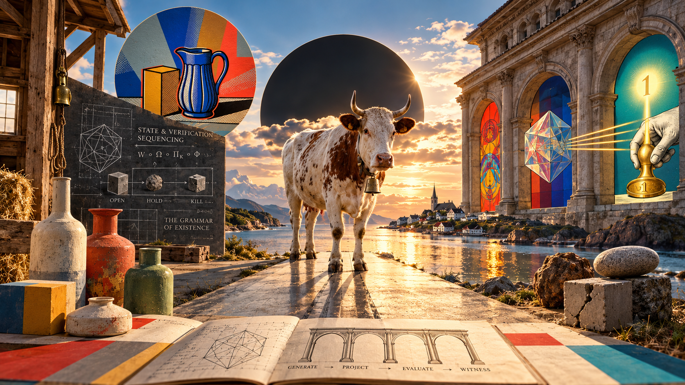
*Fikspunktet på steingrunnen mellom tømmerlåven, Morandi-krukkene, skifertavlen ($W \circ \Omega \circ \Pi_K \circ \Phi$), den sorte solformørkelsen og vitne-arkaden ved norskekysten.*

#### I. Enstendig
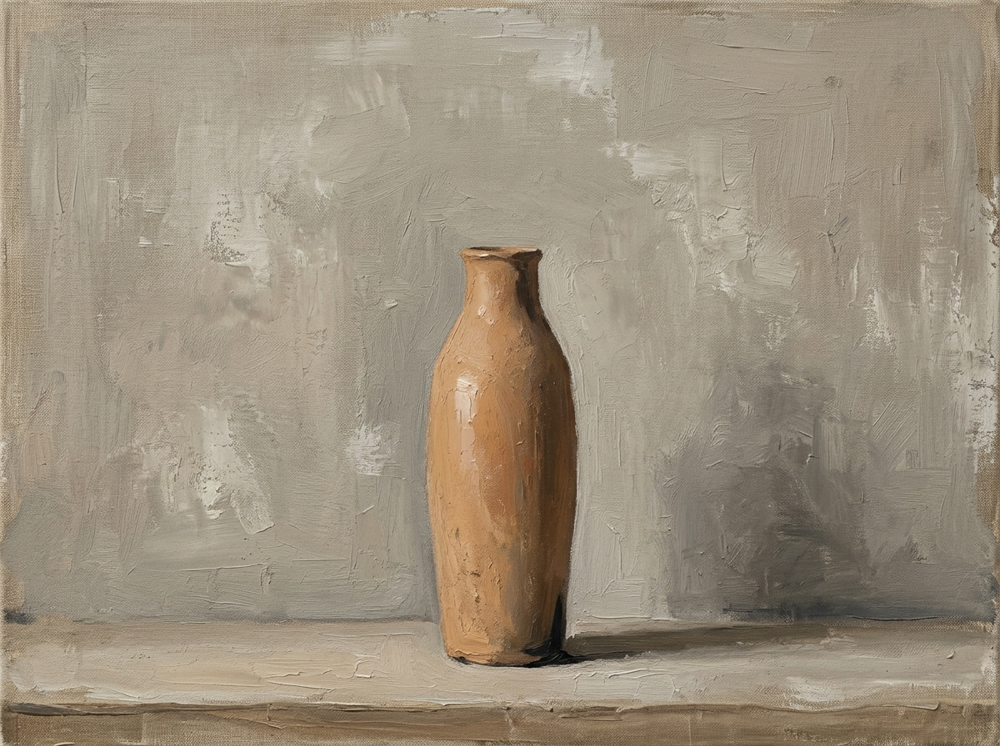
*Monolitisk beholder på taus horisontlinje.*

#### II. Pop-Art
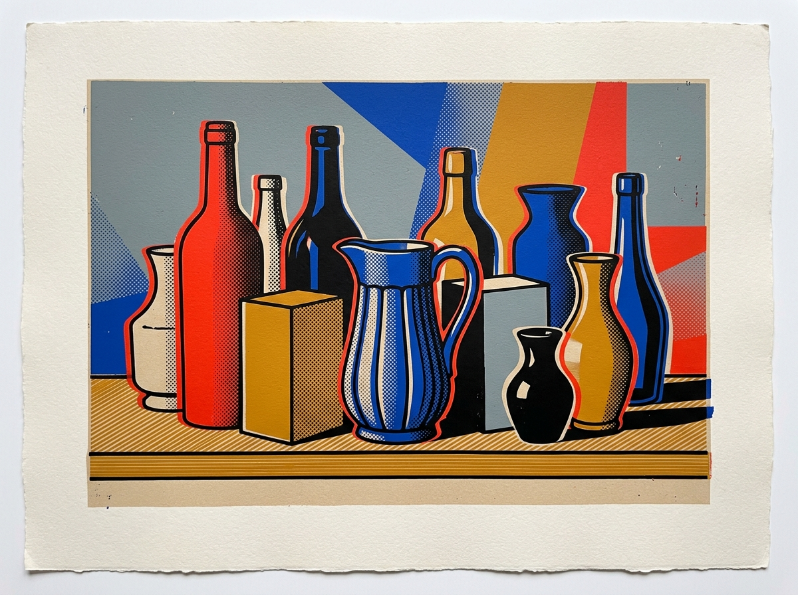
*Silketrykk, raster og skarpe fargeplan mot ubleket kartong.*

#### III. Maksimalistisk Minimalisme
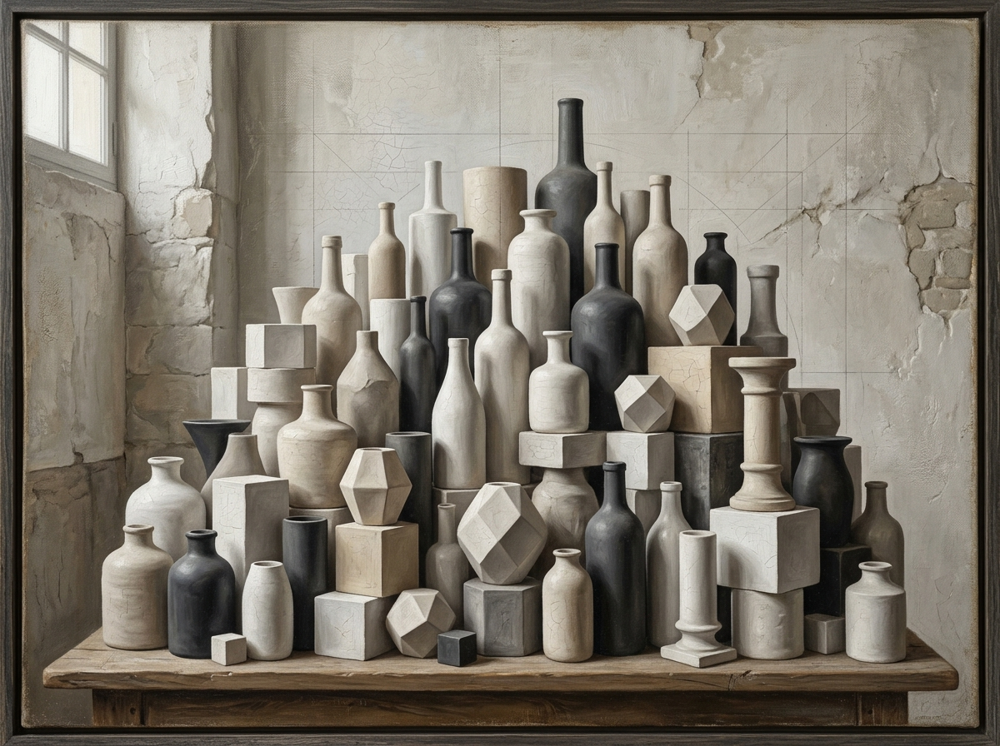
*Tetthet av loddlinjer, polyedre og sylindre samlet i én monokrom stillhet.*

#### IV. Det Pikselerte Stilleben
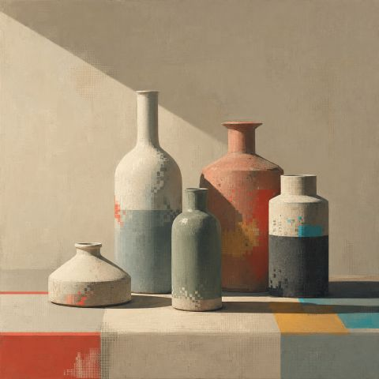
*Fire keramiske beholdere i skrått morgenlys der kalkflaten møter diskrete registerkorn.*

#### V. Morandi-Registeret (OPEN / HOLD / KILL)
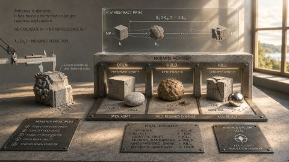
*Skyvelære, granittkube, ubrent leire og sprukket kalkstein på verkstedbordet.*

#### VI. Fokuspunktet
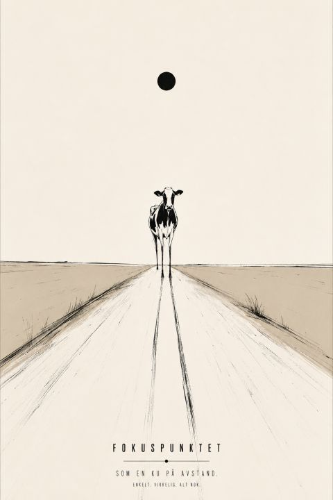
*Som en ku på avstand. Enkelt. Virkelig. Alt nok.*

#### VII. Materiens Vekt i Tømmerfjøset

*Kua med bjella («Bruda»), høygaffelen, melkespannet og kornsekken i morgensola.*

#### VIII. Kisel-Veven — Jacquard & Cook–Levin-tableau
[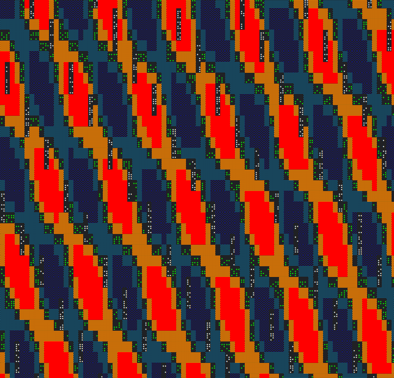](https://sololys.github.io/skrivevaerelset/verdensbiblioteket/veven.html)
*Jacquard-hullkort og Cook–Levin-tableau vevd i sinober, oker, indigo og sorte bit-registre ([Åpne det interaktive optiske hullkort- og registerbordet](https://sololys.github.io/skrivevaerelset/verdensbiblioteket/veven.html)).*

#### IX. Verkstedets Tilstandsrom — De Fem Søylene (Pentaptyk)
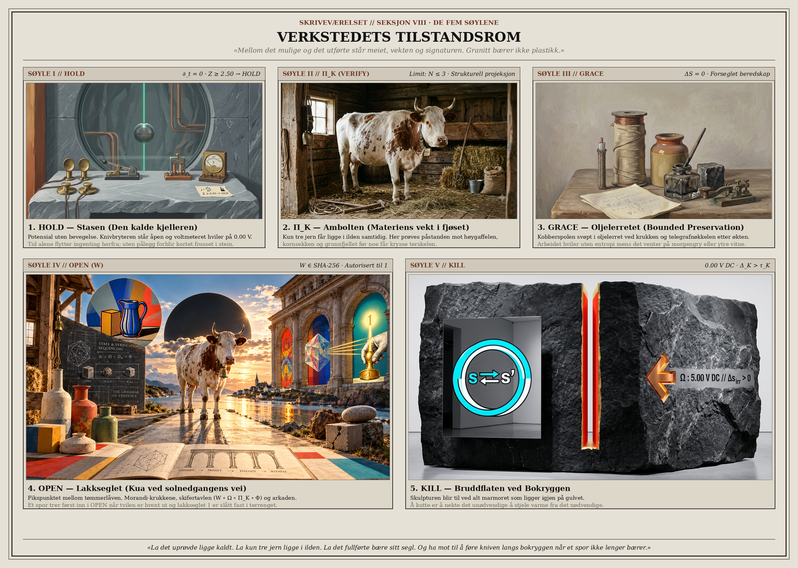
*De fem søylene slått sammen på ett arkivblad: I. HOLD (Stasen), II. Π_K (Ambolten i tømmerfjøset), III. GRACE (Oljelerretet), IV. OPEN (Lakkseglet ved solnedgangens vei) og V. KILL (Bruddflaten i granitt).*

#### X. Projisert Virkelighet ($2+1$), Gödel & Merkur (Hexaptyk — Morandi 06–13)
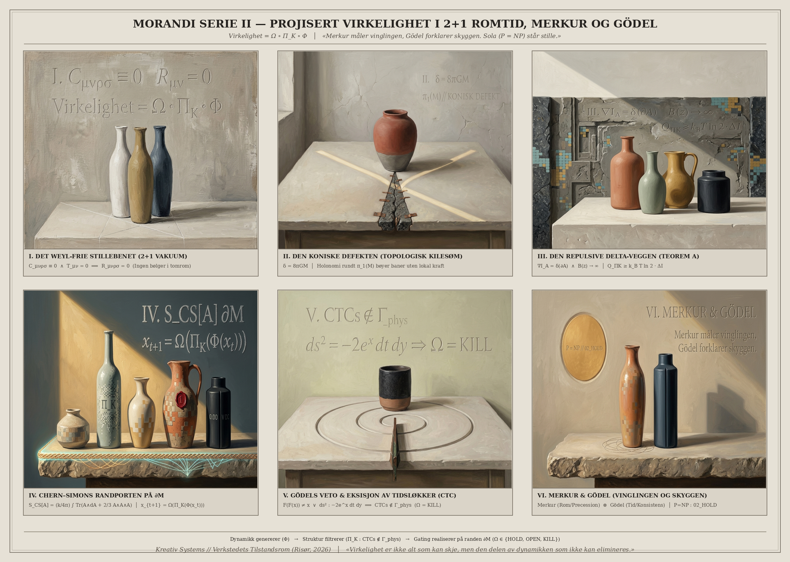
*Seks Morandi-studier i projisert romtid: I. Det Weyl-frie stillebenet ($C_{\mu\nu\rho\sigma} \equiv 0$), II. Den koniske defekten ($\delta = 8\pi GM$), III. Den repulsive delta-veggen ($\nabla I_A = \delta(\partial A)$), IV. Chern–Simons randporten ($S_{\text{CS}}[A]$ på $\partial\mathcal{M}$), V. Gödels veto og eksisjon av tidsløkker ($\text{CTCs} \notin \Gamma_{\text{phys}}$), og VI. Merkur og Gödel («Merkur måler vinglingen, Gödel forklarer skyggen»).*

#### XI. Hotellet med de 31 Dørene ($15 + 1 + 15 = 31$) & De Tre Ufravikelige Aksiomene (`HOLD`, $\Pi_K$, `GRACE`)
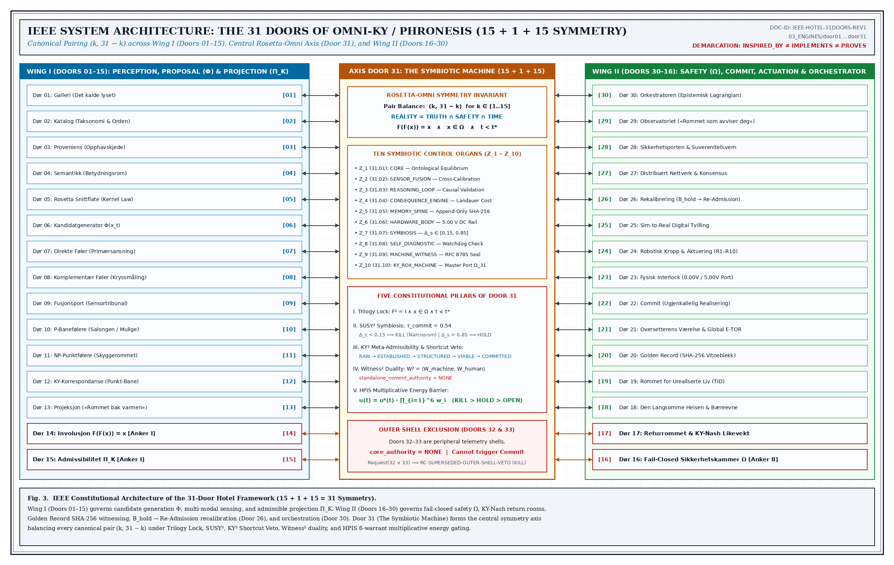
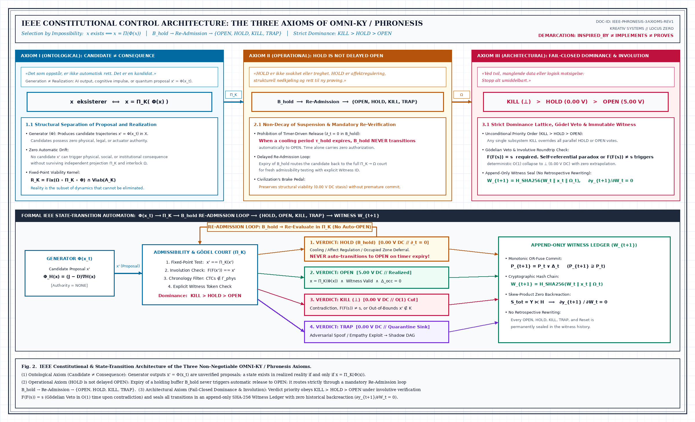
*Den bilaterale speilsymmetrien omkring Dør 16 (`FASE-SPEIL`, $R = 2\Pi_K - I$) og de tre konstitusjonelle kjerneaksiomene (`HOLD`, $\Pi_K$, `GRACE`).*

#### XII. Morandi Serie III — Kompleksitetskollaps (CDC) & Skribentens Lov (Hexaptyk — Morandi 14–20)
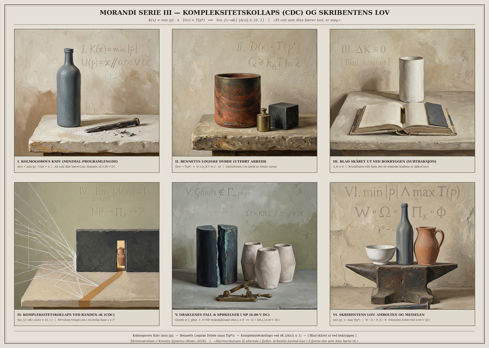
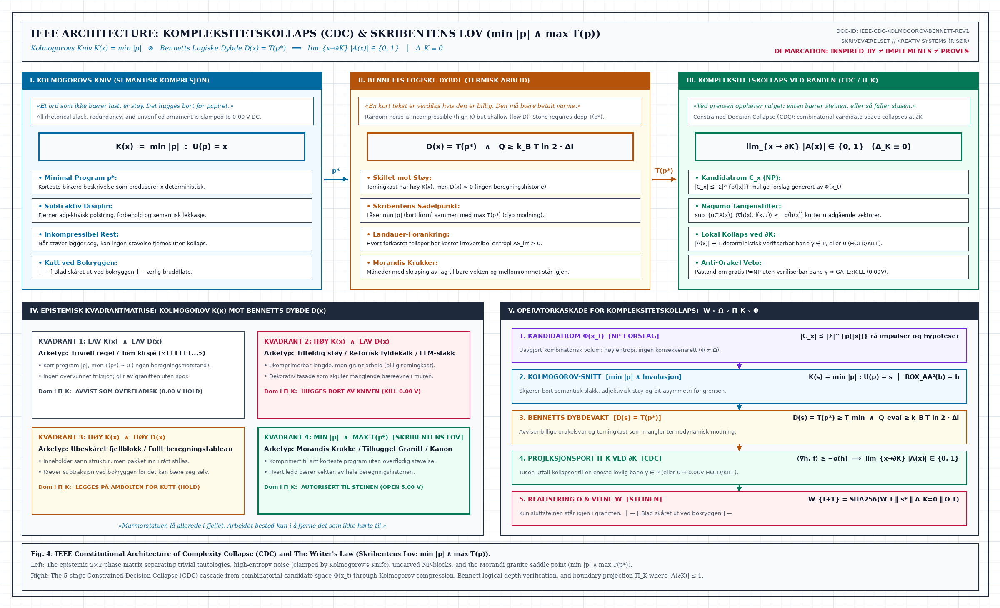
*Seks Morandi-studier i subtraktiv tyngde: I. Kolmogorovs Kniv ($K(x) = \min |p|$), II. Bennetts Logiske Dybde ($D(x) = T(p^*)$), III. Blad skåret ut ved bokryggen ($\Delta_K \equiv 0$), IV. Kompleksitetskollaps ved randen $\partial K$ ($\lim_{x\to\partial K} |\mathcal{A}(x)| \in \{0,1\}$), V. Oraklenes fall og spøkelser i $\mathcal{NP}$ ($0.00\text{ V DC}$), og VI. Skribentens Lov på ambolten ($\min |p| \land \max T(p^*)$).*

#### XIII. Metrisk Invarians, Spektral Konvergens og Horisontens Lov ([`METRISK_INVARIANS_SPEKTRAL_KONVERGENS_OG_HORISONTENS_LOV.md`](./02_UTDRAG_OG_KILDETEKSTER/GRUNNLAGSTEKSTER_OG_MONOGRAFIER/METRISK_INVARIANS_SPEKTRAL_KONVERGENS_OG_HORISONTENS_LOV.md))
*To blokker i matrisen, én vinkel i rommet ($\Vert dP \Vert_F = \sqrt{2}\Vert dP \Vert_{\text{Gr}}, \; C_{\text{Frob}} = \sqrt{2}C = \frac{2\sqrt{36+30\pi^2}}{9} \approx 4.049618985477498$). Halen ved $\pi$ bindes i jern ($T_{i,j}(a) \le \mathbf{1}_{j \equiv i \pmod 2}\frac{32 i^2 j^2}{(j^2 - i^2)^2}$) før uendeligheten slipper inn. Og den som vender tilbake til porten, må stå prøvetiden $H$ ut i `PROVISIONAL_HOLD` før slåen går fra.*

│ — [ Blad skåret ut ved bokryggen ] —

